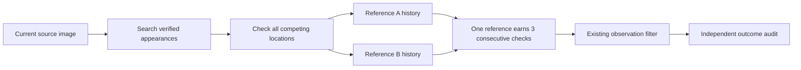

# Fraynix Agent Workspace — Edition 143

**Independent confirmation for verified appearances.** Fraynix connects durable chat goals with a Java brain, simulation, observed worlds, browser interaction, data processing, creation tools and reusable verified procedures. This edition develops one perception mechanism within that connected application.

[Previous edition](README-142.md) · [All editions](docs/readmes/INDEX.md) · [Offline guide](docs/readmes/143/index.html) · [Integrated roadmap](docs/INTEGRATED_AGENT_ROADMAP.md) · [Contributor handoff](README-CONTRIBUTORS.md)

{{HERO}}

## What changed

The optional **reference-confirmation-143** method keeps a separate confirmation history for the original appearance and each of up to six independently verified full-view examples. In edition142, two valid references could alternate as the best match and reset the sole confirmation counter. The new method searches and verifies each reference independently. One reference must earn all three consecutive confirmations; counts never move between references.

Each appearance uses the existing full-region and four fixed 75%-visible masks, textured correlation, RGB agreement and bounded scale/location search. Every appearance contributes to competing-location rejection. A reference is not allowed to declare a unique match merely because its own descriptor has no competitor. Missing, ambiguous or broken adjacent motion resets its history. The chosen output is the strongest fully confirmed reference; no weighted vote or pooled identity claim is used.

The candidate preserves all accepted foreground-guard139 proposals. Only actual underlying flow loss enables supplemental recovery, and baseline acceptance clears the supplemental histories. The baseline is never reset or retrained. **reference-monitor-143** performs the searches while preserving139 tracker/filter output. **reference-seed-143** keeps source provenance checks but disables imported descriptors. The unchanged **partial-reference-142** method is a separate comparison. **legacy-flow remains the default**.

The existing137 reference store rechecks original donor pixels, labels, implementation and outcomes. Descriptors come from independent full-view rectangles. Partial, uncertain or wrong donor observations remain excluded. Source and evaluation images must be disjoint; the operator's same-object declaration is not semantic identity proof. No target predictions enter memory. Visible support and inferred whole geometry remain distinct; neither establishes depth, metric scale or physical contact.

No new weights, external vision runtime, capacity increase, action authority or default change.

This diagram shows the supplemental path after loss. The accepted baseline path remains intact. Histories reset on missing, ambiguous or incoherent evidence; their counts are never pooled.

## Measured results

{{FINDING}}

{{RESULTS}}

Real footage and generated controls are separate. Missing measurements remain in the denominator. Low target overlap is an inaccurate box, not automatically an identity switch. A confirmed other-object match requires a separately labelled competitor. Uncertain labels cannot establish success.

“Correct” means an accepted estimate has at least 0.5 intersection-over-union with the independent target rectangle. This is an image-box criterion, not precise geometry or real-world accuracy. A confirmed competitor match needs at least 0.5 overlap with its labelled box and less than 0.2 target overlap (or an independently absent target).

The exposed edition142 reference-switching failure is a development regression, not fresh qualification. It now passes with independent histories. The results below come from the separately fixed new images and controls; misses and wrong outputs remain visible.

{{RECOVERIES}}

Additional raw boxes include measurements the filter later refuses. Supplemental measurements can influence later filter estimates; preserving baseline tracker proposals does not imply identical candidate filter history. The monitor must preserve both.

## Sources and experimental design

{{SOURCE_REVIEW}}

{{SOURCES}}

[OTB source: SNU Robot Vision Lab](https://rvlab.snu.ac.kr/research/tracker_benchmark/). FaceOcc1 and Coupon were fixed before source access. Frames 1–24 supply separate reference windows; frames 25–120 are the fixed real-footage evaluation windows. Original JPEGs and annotation bytes are unchanged; archive digests and ZIP integrity checks are retained. External benchmark geometry and AI source-only visibility/competitor labels are attributed separately. No independent human adjudication is claimed.

The image-freshness check compares exact JPEG hashes with earlier source and label manifests. Its `frames` counts are distinct hashes, so repeated identical JPEGs count once there; the tracking tables retain every frame. This check does not detect differently encoded copies.

Generated tests use new fixed textures, renderer-derived rectangles, two cover intervals and a competing copy. The copy remains visible during the second cover, explicitly testing whether appearance alone confuses another object for the absent target. They use the same donor audit, retention, durable tracking and outcome checks as footage. They establish controlled software behavior, not general camera reliability.

Implementation, thresholds, source selection, scorer and app harness were frozen before new annotations/pixels. Labels were committed before evaluation. No tuning on fresh outcomes. A donor-box representation assertion was corrected after source review but before evaluation: exact canonical arithmetic replaces exact raw-corner comparison; no tracker, threshold, scorer or label changed. Original lock and amendment are retained. Bounded windows are not a complete benchmark. Severe occlusion, arbitrary pose change, off-image whole geometry, identity ambiguity and physical accuracy remain limitations.

{{SOURCE_IMAGE}}

## Verification and recovery

{{VALIDATION}}

{{APP_CHECKS}}

Focused checks reproduce the exposed reference-switching failure, verify positive recovery without pooling counts, and exercise seed-only ablation, competing copies, absent texture, interrupted confirmation, warning-only refusal, monitor equivalence, duplicate/malformed references, contradictory outcome labels, forged traces and donor-source tampering. Every candidate decision is replayed from original pixels before independent scoring.

{{ATTEMPTS}}

Hosted CI is separate from local validation and fetched publication. Historical receipts retain their original implementation identity.

## Processing costs

{{COSTS}}

{{DIAGNOSTICS}}

Recorded search counts exclude repeated replay/restart work. Similarity is not probability. Future optimization must retain every source/outcome check and measure complete workflows.

Methods run in a fixed order while the evidence collection grows. These are elapsed workflow measurements, not an isolated or randomized speed comparison between algorithms. Later runs can pay for more accumulated state and repeated verification. No responsiveness improvement is claimed.

## Review in the app

1. Start with `scripts/Start-Agent-Workspace.ps1` using Java 21. `-PrepareOnly -Offline` checks local preparation. Keep private projects separate from evaluation projects.
2. Open **3D / World**, choose a saved world and import source footage. Import independent labels in **Object identity · occlusion & recovery**.
3. Audit a completed appearance-continuity run and retain its supported full-view appearances.
4. Import separate evaluation footage. Under **Verified reference appearances**, choose the set and explain the shared-object relationship.
5. Explicitly select independent reference confirmation or a control, confirm the world/footage binding and start. Inspect visible support, inferred rectangle, independent audit and complete export.
6. Missing or changed evidence, source overlap, incompatible code and ambiguous matches must refuse or withhold. Keep these checks intact.

## Application direction

The goal remains a local agent that observes, plans, acts, verifies and retains useful procedures across interruption. Java owns durable goals, world state and verification. Browser, canvas, data and creation tools turn those goals into working artifacts. Perception improvements must earn their role through measured task outcomes.

{{NEXT}}

## Evidence and implementation

[Verification](docs/readmes/143/verification.json) · [Actual app study](docs/readmes/143/app-study.json) · [Comparisons and timings](docs/readmes/143/comparison.json) · [Original evidence](docs/readmes/143/original-evidence.json) · [Source inventory](docs/readmes/143/file-inventory.json) · [Frozen protocol](docs/EDITION_143_CONTRACT.md) · [Source review](docs/publication143/source143.json)

[Per-reference search](workspace-engine/src/main/java/fraymus/workspace/ReferenceSearch143.java) · [Independent confirmation controller](workspace-engine/src/main/java/fraymus/workspace/AppearanceConfirmation143.java) · [Pixel replay and scoring](workspace-engine/src/main/java/fraymus/workspace/ConfirmationAudit143.java) · [Verified reference resolver](workspace-engine/src/main/java/fraymus/workspace/ReferenceMemory137.java). Earlier edition snapshots remain immutable.
