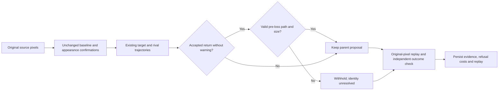

# Fraynix Agent Workspace — edition 146

**A returning appearance needs motion evidence even when no competitor warning was recorded.** This optional Java check closes the path that previously allowed a distant copy to return on appearance alone. It reuses the existing measured trajectory, keeps the original decisions visible, and independently scores both wrong returns prevented and correct returns refused.

{{FINDING}}

[Previous edition](README-145.md) · [Offline interactive guide](docs/readmes/146/index.html) · [All editions](docs/readmes/INDEX.md) · [Contributor handoff](README-CONTRIBUTORS.md) · [Architecture](docs/ARCHITECTURE.md) · [Integrated roadmap](docs/INTEGRATED_AGENT_ROADMAP.md)

{{HERO}}

## The connected application

Fraynix is a local Java agent workspace with durable chat goals, a persistent physics world, Game Lab, browser observations, data analysis and verified creation procedures. Java owns execution, state, recovery and outcome checks; the desktop provides the browser, canvas and controls. Local models choose and explain actions through installed tools. The destination remains one observable system that creates, tests and retains useful procedures from measured outcomes.

This edition strengthens one source of evidence for that system. It does not establish semantic identity or physical accuracy. A goal must distinguish a measurement from a prediction and unknown identity before acting. Better tracking must earn its place through complete world, browser and creation tasks. Defaults, permissions, private project data, existing capacities and the `legacy-flow` policy remain unchanged.

## What changed

The edition 145 ambiguity guard could remain inactive when no strong competing appearance was detected. A later confirmed appearance could then be accepted without checking its distance from the target's last observed path. The exposed copy-remains case demonstrated this gap.

`return-guard-146` wraps the unchanged edition 145 method. It checks a supplemental return only when the parent accepted it and no competing-object warning is retained. The candidate must fit the existing measured target envelope and size bounds. Missing, expired or incompatible motion evidence withholds the return. Existing baseline tracking and edition 145 restorations with separated competing trajectories remain intact. `return-monitor-146` records the same checks while preserving every edition 145 tracker and filter output.

No extra image search is introduced. The target still uses at most five adjacent baseline boxes, requires four observations, and has a twelve-frame horizon. The inherited image-plane envelope and size limits are unchanged. Predictions and recovered boxes never extend the target anchor or become saved appearances. The original parent decision stays in the trace alongside the new screening result.

These fixed motion bounds are uncalibrated assumptions. A wrong baseline can contaminate the predicted path. An unseen identical copy following that same path may be indistinguishable. Camera movement, abrupt direction changes and long disappearances can also defeat the assumption. A refusal can prevent a wrong object or lose a legitimate return; both outcomes are measured.

## Results, including refusal costs

{{RESULTS}}

Correct means a filter-accepted measurement overlaps an independently labelled visible target by at least 0.5 IoU. Hidden outputs are accepted measurements while the target is labelled completely occluded or out of view. Wrong overlap alone does not establish an identity switch; overlaps with explicitly labelled competing objects are reported separately. Missing observations remain in every denominator. The [full comparison](docs/readmes/146/comparison.json) retains every method, source and unavailable comparison.

{{RECOVERIES}}

New146 refusals are distinct from inherited143/144/145 refusals. Raw appearance proposals, downstream filter acceptance and final tracking totals are different measurements. A correct proposal withheld by the new check is a cost, even if the shared filter would have rejected it anyway.

{{DEVELOPMENT}}

## Fresh footage review and remaining qualification gap

The method, scorer, UI, generator, app harness and source-selection criteria were frozen at `236d4b2f` before new pixels were accessed. The [contract](docs/EDITION_146_CONTRACT.md), [method lock](docs/OBSERVATION_146_LOCK.json) and [selection record](docs/publication146/source-selection146.json) define the protocol.

Sources come from the [original OTB benchmark](https://rvlab.snu.ac.kr/research/tracker_benchmark/). The predeclared order is Coke, Subway, Woman and Human4. Selection uses source images, never tracker outcomes: the earliest eligible complete disappearance and return, ten visible/partial frames before and after, a bounded contiguous evaluation, and a disjoint source-qualified donor. Every rejected source or event remains recorded. A later donor-admission refusal does not trigger an easier replacement.

**None of the four sources met both frozen eligibility requirements.** A supplemental Coke run preserves complete occlusion255–263 and return264, with an all-partial donor and explicitly unavailable145/146 comparisons. Generated-source preparation also found three exact donor/evaluation duplicates per case. Those cases remain fixed diagnostics, never fresh qualification. See the [pre-prediction amendment](docs/publication146/AMENDMENT-source-unavailable.md).

{{SOURCE_REVIEW}}

{{SOURCES}}

External benchmark rectangles are supplemented by attributed source-only AI visibility and competitor review. This is not independent human adjudication. Source annotations and uncertainty are committed before predictions. Original archives, checksums, CRC checks, annotation bytes and selected frame hashes are retained. No raw camera archive or private webcam footage is published. Camera motion and similar objects are reported only where the actual source supports them.

The donor rule permits a disjoint window before or after the evaluation event. Exact source-frame ranges disclose that ordering. This is an offline test with a previously supplied reference; a donor later in the original video does not establish causal, reference-free live tracking.

{{CAMERA_SHOTS}}

Generated overlapping-source diagnostics test a short legitimate return, a distant surviving copy, a same-path unseen copy and a delayed legitimate return. The same-path copy and short return have identical pixels after a declared identity substitution. They illustrate an observability limit and are not independent image trials. Generated geometry and already-exposed regressions do not establish camera reliability.

## Review the behavior

1. Launch `Launch-Agent-Workspace.bat` with Java 21 and the existing desktop prerequisites. Offline preparation is available through `scripts/Start-Agent-Workspace.ps1 -PrepareOnly -Offline`.
2. Use an isolated project. In the spatial workspace, select a saved world and import a frame pack.
3. Import independent source labels, audit a separate donor and retain its verified appearances. A successfully tracked donor does not automatically produce admissible examples.
4. Select the evaluation footage and verified reference set. Compare `trajectory-guard-145`, `return-monitor-146`, and `return-guard-146` explicitly. A same-object declaration is required; it is not identity proof.
5. Inspect original frames, the return-continuity explanation and independent outcome audit. The app distinguishes unsupported motion, size incompatibility, expired evidence and preserved baseline continuity. Charts distinguish measured, estimated and predicted positions.
6. Export the complete evidence or resume an interrupted run. Original source and code checks still apply; incompatible historical proofs are not relabelled.

The [offline guide](docs/readmes/146/index.html) provides source comparisons, actual screenshots, implementation links and a searchable file inventory without running new experiments.

## Verification and retained attempts

{{VALIDATION}}

{{APP_CHECKS}}

The [interruption check](docs/readmes/146/restart-check.json) repeats the already-exposed copy-remains regression, kills only its owned Java process during loss without a competing warning, then reconstructs the original pre-loss evidence and compares the full resumed trace and audit. This is durability evidence, not another fresh sequence. [Diagnostics](docs/readmes/146/diagnostics.json) verify preserved parent proposals, new refusal preconditions and target anchors that never advance from restored predictions.

Each camera source uses its own isolated comparison project, with a separate generated project and exposed-regression project. Existing frame, dataset, run and export limits remain in place. No evidence is pruned to fit. If a donor has no verified examples, its refusal and fixed baseline result remain explicit; dependent146 checks are unavailable on that source.

{{ATTEMPTS}}

CI was checked before implementation: both edition 145 runs passed. An older edition 144 metadata run failed one calibration test while its release passed; that original failure remains recorded and the unchanged calibration test is included in local146 verification. Hosted CI after publication remains separate from local success. See [GitHub Actions](https://github.com/eyeoverthink/Fraynix-Agent-Workspace/actions) and the publication receipt for the actual release status.

## Complete workflow cost

{{COSTS}}

The new screen reuses existing motion evidence and adds no image search. This does not make the full workflow free: original-source replay, reference verification, persistence, reopening and export remain required. Fixed-order timings are descriptive measurements, not an isolated speed comparison. No verification is skipped.

## Source and preserved evidence

- [Return controller](workspace-engine/src/main/java/fraymus/workspace/ReturnContinuity146.java), [independent audit](workspace-engine/src/main/java/fraymus/workspace/ReturnAudit146.java), [focused tests](workspace-engine/src/test/java/fraymus/workspace/ReturnContinuity146Test.java), and [actual app harness](workspace-desktop/test/return146-integration.cjs).
- [Unchanged145 controller](workspace-engine/src/main/java/fraymus/workspace/TrajectoryRecovery145.java), [motion bounds](workspace-engine/src/main/java/fraymus/workspace/TrajectoryGate145.java), [appearance confirmation](workspace-engine/src/main/java/fraymus/workspace/AppearanceConfirmation143.java), and [verified reference resolver](workspace-engine/src/main/java/fraymus/workspace/ReferenceMemory137.java).
- [Verification](docs/readmes/146/verification.json), [source selection and labels](docs/publication146/source146.json), [original evidence inventory](docs/readmes/146/original-evidence.json), [file inventory](docs/readmes/146/file-inventory.json), and [linked system map](docs/obsidian/154-return-continuity.canvas).

Historical editions001–145 remain frozen. Publication targets `eyeoverthink/Fraynix-Agent-Workspace` main, edition146 and annotated `readme-146`, followed by fetched Git-file verification. The unified Java world/browser/creation application remains the destination.

{{NEXT}}
