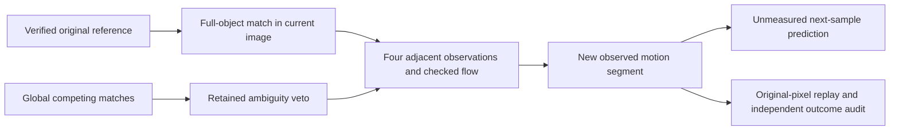

# Fraynix Agent Workspace — edition 149

**Recognize a returning object from fresh observations, then rebuild its motion history.** This edition adds an explicit Java experiment alongside the existing trackers. The default stays unchanged.

{{FINDING}}

[Previous edition](README-148.md) · [Offline guide](docs/readmes/149/index.html) · [All editions](docs/readmes/INDEX.md) · [Contributor handoff](README-CONTRIBUTORS.md) · [Architecture](docs/ARCHITECTURE.md) · [Integrated roadmap](docs/INTEGRATED_AGENT_ROADMAP.md)

{{HERO}}

## The connected application

Fraynix remains one local application connecting chat, a persistent Java physics world, Game Lab, browser observations, data analysis and verified creation procedures. Java maintains tasks, state, execution and recovery. The desktop presents the browser, canvas and controls; a local model can choose and explain installed actions. The destination is a system that observes, creates, tests and retains useful procedures from measured outcomes.

Tracking supplies evidence to that system. A similar-looking image is not sufficient authority to manipulate a physical object. Measured, predicted and unknown states must remain distinct in reports and action checks. This edition improves an optional observation path; it does not replace the app with a camera demo, add cloud inference, expand permissions or alter private worlds.

## What changed

- **Fresh full-object evidence:** verified original donor crops produce 16 × 16 spatial/color descriptors. The initial user-selected source crop also participates; its selected identity is an input assumption, not an independently certified identity. The full image region must match, including its quadrants and gradient structure. Partial matches cannot establish a new identity segment.
- **Separate confirmation for each reference:** four adjacent full matches and checked optical flow are required. Missing, ambiguous or incoherent frames reset that reference’s history. References cannot pool confirmations.
- **Retained ambiguity:** a known competing match remains a veto on added 149 measurements after it disappears. One surviving candidate does not erase evidence of a copy.
- **New observed motion:** after confirmation, fit the most recent four or five measured boxes. The segment records its source reference and sample ordinals. It carries no velocity across the long cover.
- **Honest forecasts:** the next-sample point is visibly marked as predicted. It never counts as an observation, appearance memory or identity confirmation. Fit residuals are not calibrated probability bounds.
- **Exact compatibility:** `identity-monitor-149` keeps all 148 tracker/filter outputs. `identity-return-149` preserves accepted 148 proposals and can add measurements where 148 withholds them. The inherited parent can still make mistakes; this compatibility promise does not correct those errors.

No new model, transformer, cloud service or production library is required. All source, code, label, outcome and export checks remain. Limits remain six reference examples, 96 frames per dataset, 16 datasets, 24 runs and 20 MB exports. The older twelve-sample path horizon and eight-rival limit remain unchanged. No automatic appearance admission, default promotion or physical action authority is added.

“Full object” here means the complete reference rectangle, rather than one of the older partial masks. It is not a foreground segmentation or semantic recognition of a lighter. Background pixels, rotation and changes in the visible shape can still prevent a match. A fresh motion segment cannot compensate for missing identity evidence.

A recent strong match can suggest one extra bounded search region. It does not confirm the current frame: all full-object and global-rival checks still run. The initial frozen implementation missed objects between coarse-grid positions and added zero returns on nine reserved sequences. That failed cohort is preserved; the revised search uses another reserved cohort. Geometry bounds are also enforced before refined candidates enter confirmation.

## Why a new motion segment

The forecast has no path back into reference admission or identity confirmation.

Edition 148’s camera recording exposed a long hidden interval, a brief return at the original location, hand-assisted movement and failure to follow the final position. The old forecast had expired, and two brief baseline observations could not rebuild its required trajectory. Extending that forecast until it happened to fit would manufacture confidence.

Edition149 instead asks a different, observable question: do several new full-object matches agree with the original selected crop or a verified donor appearance, without a known competitor? Only then does it form a new observed segment. The [fixed protocol](docs/publication149/PROTOCOL_149.md) and [implementation lock](docs/OBSERVATION_149_LOCK.json) precede reserved-control execution. The older recording is **exposed regression material**, not a fresh camera validation.

## Evidence and results

The original 148 webcam packs and committed source-only labels are reused unchanged as an exposed regression. Any new 149 capture is declared separately under the [fresh camera protocol](docs/publication149/CAMERA_PROTOCOL_149.md). Donor admission is repeated under the current implementation; old code-bound evidence is never relabelled. Original images and sampled RGB appearance arrays remain private. Published camera receipts are clearly marked derived views: they preserve measurements, decisions and source hashes, with hashes for omitted feature arrays and the complete unchanged private original. Public views cannot replace original evidence in the verifier. Their source-only labels were independent of the original predictions, but they are manual AI annotations, not instrumented ground truth.

{{SOURCE_REVIEW}}

{{RESULTS}}

Correct means at least 0.5 overlap with the independently labelled target. Missing observations stay in the denominator. Hidden outputs, bad overlap and labelled-other-object matches are reported separately. Unlabelled distractors cannot establish switch-free tracking.

{{RECOVERIES}}

{{RESERVED}}

{{MOTION}}

Raw supplemental boxes and measurements accepted by the shared filter are different results. Reserved generated cases test exact rendered geometry and repeatable logic; they cannot establish real-camera generalization. Fresh webcam confirmation remains a separate qualification requirement unless explicitly documented here.

## Fresh camera qualification

{{FRESH_CAMERA}}

## Review in the app

Use the existing Windows launcher with Java 21 and the installed desktop dependencies. Preserve the private project path when switching checkouts. The edition 149 verification runs use isolated projects under `build`; they do not touch the active review world.

1. Open the spatial view and import an authorized observation pack. Review and freeze source-only labels before evaluating a new source.
2. Run and independently audit a separate clear donor; retain only supported fully visible appearances.
3. Select the evaluation footage and a verified donor set. Explain why they show the same object. This declaration is not itself identity proof.
4. Choose **Fresh identity monitor 149** to inspect decisions while retaining 148 outputs, or explicitly choose **Fresh full-object identity + new motion segment 149** for the candidate.
5. Review every missing and unsupported measurement in **Object identity · occlusion & recovery**. The source view shows the observed segment and a dashed predicted point. Stop/resume and evidence export preserve the original checks.

Public screenshots show the actual saved app results with camera pixels hidden. Reproducing the camera comparison requires authorized access to the original local files. The published hashes alone cannot reconstruct the recording.

## Verification and complete cost

{{VALIDATION}}

{{POSITIVE_CHAIN}}

{{APP_CHECKS}}

A separate exposed generated control runs positive new returns through the unchanged observation filter, reconstructs the tracker/filter from original frames and checks the independent audit. Changing its outcome label changes the score without changing the tracker; forging a segment is refused. Its fixture memory is not a production admission proof. Real-app source admission and interruption are checked separately on camera footage, which has no added149 return. Positive new-segment recovery across a native-app process interruption remains unqualified.

{{COSTS}}

{{ATTEMPTS}}

The implementation is pure Java image processing and bounded state. CPU search and original-pixel replay have real costs; successful execution is separate from useful recovery and from real-time throughput. Hosted CI status is separate from local verification and fetched publication.

## Limits and next work

An unseen pixel-identical substitution is not observable from this camera alone. Camera motion, rotation, changing light, small objects and partial returns can prevent confirmation. The new segment uses **image/sample units**, not calibrated seconds or physical velocity; original camera timestamps remain in private source data. Independent physical evidence is needed before claiming real-world identity or permitting physical action.

{{NEXT}}

Maintain the unified Java world, browser, creation and durable-chat architecture. No stubs, invented outcomes, silent changes to defaults or overwritten historical evidence.
