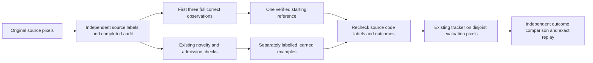

# Fraynix Agent Workspace — edition 150

**Keep a verified starting reference even when nothing new has been learned.** This edition separates source validity from appearance novelty, improves the private recorder's timing cues, and tests returns through the existing Java tracking and verification pipeline. Tracking defaults and identity thresholds stay unchanged.

{{FINDING}}

[Previous edition](README-149.md) · [Offline guide](docs/readmes/150/index.html) · [All editions](docs/readmes/INDEX.md) · [Contributor handoff](README-CONTRIBUTORS.md) · [Architecture](docs/ARCHITECTURE.md) · [Integrated roadmap](docs/INTEGRATED_AGENT_ROADMAP.md)

{{HERO}}

{{CAPTURE_DATES}}

## The connected application and its destination

Fraynix remains one local application connecting chat, a persistent Java physics world, Game Lab, browser observations, data analysis and verified creation procedures. Java owns durable tasks, state, validation and recovery; the desktop hosts the browser, canvas and controls. A local language model can choose and explain installed actions. The destination is an agent that observes, builds, tests and retains useful procedures from measured outcomes.

The camera work supplies evidence to that architecture. It is not a replacement for the world, browser or creation tools. Observed, predicted and unknown states must remain distinguishable. Image similarity does not authorize physical manipulation, certify semantic identity or resolve an unseen identical substitution.

| Area | Existing application role | Evidence and scope |
| --- | --- | --- |
| Chat and durable tasks | A configured local model chooses installed actions; Java maintains task state, checks outcomes and resumes interrupted work. | [Connected task evaluation](README-126.md). This camera study makes no new language-model capability claim. |
| World and Game Lab | Persistent scene state, actual physics execution, construction, playable levels and controller experiments. | [Integrated roadmap](docs/INTEGRATED_AGENT_ROADMAP.md), [level creation plan](docs/PLAYABLE_LEVEL_CREATION_PLAN.md). A simulation result is not independent physical-world truth. |
| Data and creation | Analyze fresh input, build working artifacts, verify calculated values and retain qualified procedures. | [Fresh-input implementations](README-103.md), [numerical and restart checks](README-107.md). Retained code still needs fresh source/outcome checks. |
| Browser and observation | Use the hosted browser and installed observation tools; connect evidence to a durable task or artifact. | [Observation-to-artifact workflow](README-128.md). Tool access follows installed capabilities and policy. |
| Procedure history | Inspect, retire and reactivate saved procedures while preserving evidence; archive completed history within the existing active limits. | [Procedure lifecycle](README-127.md), [history architecture](README-113.md). Persistence does not itself establish improved performance. |
| Camera references | Separate a verified starting observation from newly learned appearances, then compare recovery on disjoint footage. | This edition's measured results and original-source checks below. No automatic appearance admission or default promotion. |

## Run the workspace locally

Use JDK 21, Node.js/npm and the repository's Gradle wrapper. The Windows launcher checks Java and Node, prepares the engine and verifies the locked desktop dependencies. A first preparation may need network access to obtain dependencies; `-Offline` uses an already prepared cache. Local-model chat additionally needs the chosen model/server available locally. Web browsing still needs access to the requested sites.

From a fresh checkout, choose a separate project for review:

```powershell
git clone https://github.com/eyeoverthink/Fraynix-Agent-Workspace.git
cd Fraynix-Agent-Workspace
$env:FRAYNIX_WORKSPACE_PROJECT = Join-Path $env:USERPROFILE '.fraynix-agent-workspace/projects/edition150-review'
.\scripts\Start-Agent-Workspace.ps1
```

For an already provisioned installation, prepare and validate without opening the interface:

```powershell
.\scripts\Start-Agent-Workspace.ps1 -PrepareOnly -Offline
```

Keep an existing private project's path explicit when continuing it. Use **Stop Java & close app** before rebuilding an installation it owns; closing only the desktop may leave the Java runtime active. The launcher checks ownership before rebuilding. The edition 150 tests use isolated project directories and preserve the existing review world. See [the launcher](scripts/Start-Agent-Workspace.ps1) for the actual preparation and ownership checks.

## The gap this edition addresses

In edition 149's exploratory recording, the donor tracked all 23 scored samples correctly, yet every considered new appearance was already represented. The learned-example path correctly rejected duplicates. Because no learned set existed, reference-dependent tracking was unavailable. The successful simple fallback was not a success of the new recovery method.

Edition 150 adds a separate explicit retention action. It does not lower novelty thresholds or pretend repeated frames are new learning. A valid, independently checked starting observation can supply a reference while the learned-example count remains zero.



## What changed

- **Explicit starting reference:** the first three scored source observations must be fully visible, accepted and independently correct, with target overlap at least 0.85 and labelled-other-object overlap below 0.2. A missing or unsuitable start refuses; later good samples cannot replace it.
- **Original pixels, independent box:** one descriptor is rebuilt from the first scored observation (ordinal 1) and its independent label. In these donor clips, that is original recording frame 2; original frame 1 is the unscored seed at ordinal 0. The seed is not independently certified. Saved evidence records one starting reference and zero newly learned appearances.
- **Durable and inspectable:** the new kind uses the existing atomic, content-addressed reference store. The UI distinguishes starting references from learned examples. Reopening and use repeat the original source, code, label, outcome and descriptor checks.
- **Unchanged recovery algorithms:** existing foreground139, parent148, monitor149 and candidate149 are compared. The new action supplies verified source evidence; it does not change their matching thresholds, learned admission rules or physical authority.
- **Clear recorder timing:** a visible countdown and explicit COVER / MOVE AND UNCOVER windows replace contradictory pacing. Completion saves automatically. A missed deadline preserves an incomplete attempt and releases the camera.

Limits remain six selected reference examples, 64 retained sets shared by both kinds, 96 frames per dataset, 16 datasets, 24 runs and 20 MB exports. Evaluation images cannot also be donor images. Same-object correspondence remains an operator declaration, not semantic proof. No model, cloud service or external production library was added. The default remains `legacy-flow`; no candidate is promoted.

## Review it in the app

1. Use an isolated project or preserve the current private project path. Start with the existing Windows launcher, Java 21 and installed desktop dependencies.
2. Import a clear source recording and independent source-only labels before tracking. Run **Continuity and checked appearances**, then compare it with the independent labels.
3. In **Object identity · occlusion & recovery**, open that verified comparison and click **Retain verified starting reference**. The UI reports one starting reference and zero new learned appearances. The existing learned-example export remains separate.
4. Choose disjoint evaluation footage. Open **Verified reference appearances**, refresh the list, select the entry marked **verified start · 0 learned**, and explain the same-object correspondence.
5. Explicitly select a reference-dependent experimental method. Review missing samples, wrong overlaps, labelled distractors, hidden outputs and the cost. Keep forecasts separate from measured observations.
6. Export the complete evidence or reopen the project. A public hash or derived publication view cannot replace original private images when the verifier rechecks the evidence.

## Recorder and fresh footage


The private study recorder starts camera access only when **Start private preview** is clicked. It records no microphone audio.

| Stage | Required action |
| --- | --- |
| 34 clear samples | Both lighters visible; hands away. |
| COVER · 12 seconds | Cover all of black, remove hand, click Covered. Keep red visible. |
| 18 covered samples | Hold black fully hidden. |
| MOVE AND UNCOVER · 15 seconds | Move the whole black lighter under cover, reveal immediately, remove hand, click Returned. Do not wait for another cue. |
| 24 return samples | Leave both objects still; automatic save and camera release. |

The source contract fixes donor frames 1–24 and every evaluation frame 25–end. All frames and actual timestamps remain. A brief partial reveal transition is retained and scored; no hidden interval is trimmed. Source eligibility is checked before predictions. See the [prospective camera contract](docs/publication150/CAMERA_PROTOCOL_150.md) and [method protocol](docs/publication150/PROTOCOL_150.md).

{{FRESH_CAMERA}}

## Sources and outcomes

{{SOURCE_REVIEW}}

{{RESULTS}}

Correct means at least 0.5 overlap with the independently labelled target. Missing measurements remain in the denominator. Wrong overlap, hidden measurements and matches to labelled other objects are separate counts. Manual source-only camera labels are independent of predictions but are not externally instrumented truth. The differently colored red lighter does not establish identical-lookalike discrimination.

{{RECOVERIES}}

{{REFERENCES}}

Generated controls are exposed rendered examples, not fresh-camera evidence. Reusing an earlier recording is exposed regression. Availability of a retained reference, software correctness and useful camera recovery are separate findings. Unavailable or failed methods must remain explicit.

## Verification and restart

{{VALIDATION}}

{{APP_CHECKS}}

{{RESTART}}

The initial reference, descriptors and forecasts do not train themselves. Independent labels remain downstream outcome evidence for evaluation footage. No predicted anchor or recovered estimate becomes a new source appearance automatically.

## Measured cost

{{COSTS}}

Times include the actual local CPU workload and original-source replays. They are not a real-time throughput guarantee. Tracking time alone omits import, retention, verification, export, restart and UI costs. Faster execution must preserve every source and outcome check.

## Attempts, limitations and provenance

{{ATTEMPTS}}

Private camera pixels, sampled RGB descriptors and private project stores stay local. Publication includes camera-free app screenshots, source hashes, labels and clearly marked derived receipt views. Omitted arrays retain hashes and the complete private original's hash/length. Derived public views cannot substitute for original verifier inputs. Historical editions 001–149 retain their frozen bytes.

[Verification](docs/readmes/150/verification.json) · [Comparison data](docs/readmes/150/comparison.json) · [Original evidence inventory](docs/readmes/150/original-evidence.json) · [Source declaration](docs/publication150/source150.json) · [Implementation lock](docs/OBSERVATION_150_LOCK.json)

## Next steps

{{NEXT}}
