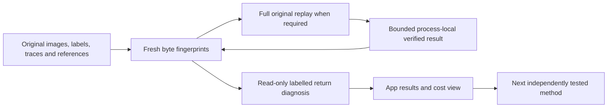

# Fraynix Agent Workspace — edition 151

**Explain the failed return. Reopen verified evidence without repeating the same expensive computation.**

[Previous: edition 150](README-150.md) · [All editions](docs/readmes/INDEX.md) · [Offline interactive guide](docs/readmes/151/index.html) · [Implementation contract](docs/publication151/plan151.md) · [Verification](docs/readmes/151/verification.json)

{{FINDINGS}}

{{HERO}}

These are actual application captures from 2026-11-16. Original webcam pixels are hidden in published screenshots and remain in the local evidence project. The camera was not opened for this edition. The footage was already exposed in edition 150; it is diagnostic material, not a fresh evaluation set.

## The application we are building

Fraynix remains a local visual agent workspace, with Java owning durable work, observations, world state, procedures and verification. The desktop presents chat, browser, canvas and simulation views. The purpose is a system that can relate a request to a world, act through installed capabilities, inspect the result and retain a procedure only when its checks pass. The Game Lab is a runtime for experiments, construction and playtesting; it is one part of that wider application.

| Area | Existing responsibility | What this edition changes |
| --- | --- | --- |
| Java brain and coordination | Durable goals, planning, scheduling, recovery, memory and verified procedures | Preserves these systems; adds evidence-opening and diagnostic services |
| Chat | Requests connected to installed world, data, browser and creation procedures | No model or planner change; no LLM-weight training claim |
| World and physics | Persistent bodies, construction, manipulation, forecasts and measured outcomes | No world mutation or physics change |
| Game Lab | Level construction, native playtesting, bounded repairs and controller evaluation | Preserved; not rebenchmarked in this edition |
| Browser and canvas | Live web interaction and working artifacts with outcome checks | Preserved; not rebenchmarked here |
| Camera observations | Source-bound tracks, independent labels and explicit experimental methods | Read-only return diagnostics; no new tracker or default promotion |
| Evidence and procedures | Original sources, code identities, verification and retained history | Faster repeated opening of unchanged audit results |

The system is not an omniscient observer. A forecast is not a measurement, a plausible crop is not an identified object, and a successful software execution does not establish physical accuracy. Java provides ownership and a shared runtime; useful intelligence still has to earn its claims through task outcomes.

## What went wrong with the displaced lighter

Edition 150 retained the starting appearance correctly, but its experimental return tracker did not reacquire the displaced black lighter. This edition investigates that failure using the same independent boxes and untouched original recordings.

The diagnostic opens the original completed audit, checks the source and code, and compares three things:

1. **The actual search hypotheses** saved during the original run, including eligibility, rival veto and confirmation history.
2. **The independently labelled target crop**, scored with the original appearance equations and thresholds.
3. **Bounded label-guided probes** that vary orientation, small crop offsets and crop geometry.

The probes use ±20 degrees in 2-degree increments, offsets of −2, 0 or +2 pixels on each axis, and either the labelled rectangle or the original seed dimensions centred at the labelled location. The best correlation determines the displayed probe. These are retrospective hypotheses supplied with the answer's location. They do **not** establish a working search procedure, actual physical orientation or recoverable identity.

{{DIAGNOSIS}}

The original appearance thresholds remain correlation ≥0.94, color error ≤0.10, maximum quadrant error ≤0.14 and gradient agreement ≥0.85. The UI names the checks that failed. Thresholds were not relaxed to make this known recording pass. Partial and hidden crops are excluded from full-object diagnostic scoring and remain present in the original audit.

The red lighter is a distinct object with a different color and similar overall shape. It is useful as a labelled distractor, but does not prove rejection of visually identical substitutes. No method here can establish identity through an invisible identical substitution.

## Faster reopening, with the original evidence still checked

`ReplayEvidence151` is a process-local memo of **completed original audits**. It does not change the tracker, its saved code identity, the original audit implementation, export verification or appearance admission.

On every opening it rereads and hashes the complete observation namespace, label/audit namespace, retained-reference namespace, workspace implementation container and JSON implementation container. It hashes them both before and after obtaining the result. The observation state includes the original traces and outcomes; retained references include the donor evidence. A successful identical opening can reuse the previously computed result. A different result is never trusted merely because its own checksum is valid.

Cold starts, changed evidence and the explicit **Replay every frame again** button use the original full verifier. There is no persisted trusted cache. Missing observation history is refused without creating an empty replacement. Failed verifications are not memoized. Returned JSON is detached from the stored entry. At most eight results are retained; file/byte bounds limit fingerprint work, and oversized evidence falls back to the original verifier. Linked evidence paths are refused by the memo path.

This is a reduction in repeated proof computation. It is not an improvement in live camera speed or first-time tracking, and it does not turn a failed physical result into a successful one.

{{COSTS}}

The byte column counts the two memo fingerprint passes, excluding additional internal I/O in the original verifier. Coordination-only lock files are not evidence inputs; namespace-presence markers are included in the internal `filesHashed` entry count. Measurements include both evidence fingerprint passes and the Java audit opening, not just a map lookup. Actual UI opening also paints a source sample and therefore has additional presentation cost. The recordings, reference counts and source sizes are bounded; larger banks, slower disks and changing observations can reduce or eliminate the benefit. A running observation changes evidence and therefore invalidates reuse.

## Try it in the app

Use JDK 21, Node.js/npm and the repository's Gradle wrapper. The [Windows launcher](scripts/Start-Agent-Workspace.ps1) prepares the Java engine and desktop dependencies. Initial preparation may need a download; offline preparation needs the existing dependency cache. Local chat needs the chosen local model/server; web browsing needs the requested sites. No new library was added for this edition.

```powershell
.\scripts\Start-Agent-Workspace.ps1
```

For preparation without starting a review:

```powershell
.\scripts\Start-Agent-Workspace.ps1 -PrepareOnly -Offline
```

Keep each edition's private project separate when reviewing historical evidence; never silently share a live database across checkouts. Use **Stop Java & close app** before rebuilding an installation it owns. The edition151 studies use separate copied projects and leave the original review data intact.

1. Open **3D / Spatial**, then **Object identity · occlusion & recovery**.
2. Select an existing completed comparison and press **Recheck comparison**. The cost line distinguishes a full replay from verified reuse and reports elapsed time and bytes rehashed.
3. Press **Replay every frame again** to force a fresh full original verification.
4. For a completed identity-149 comparison, press **Diagnose shifted / rotated returns**. Inspect target scores, best probe scores, failed checks and original search overlap. This is an explicit read-only research action.
5. Restart the app and open the same comparison. Its first opening replays again. No process-local receipt survives as authority.

The diagnostic requires retained original sources, labels, run and references. A public screenshot, condensed result or privacy-filtered JSON cannot replace those originals. Existing incompatible evidence stays historical; no code identity is rewritten.

## Evidence, tests and limitations

{{VALIDATION}}

{{ATTEMPTS}}

The app studies copy completed edition150 projects byte-for-byte to isolated private directories, compare every returned audit with the unchanged original, verify zero observation writes and an unchanged native world, and check that the source projects remain untouched. The camera study includes same-size, restored-timestamp source corruption, refusal, restoration and an actual app restart. Generated positive-return and wrong-pattern controls are reported separately from the camera.

The scoring checks compare the diagnostic against the original149 implementation, exercise known translation and quarter-turn pixel correspondence, and reject flat, wrong and out-of-frame patterns. Memo tests cover caller mutation, cold/warm/forced reads, altered pixels and labels, forged outcomes, missing history, namespace changes and bounded eviction. The original selected association, reference and identity tests remain part of the regression.

Hosted CI is checked before work and separately before publication. Local passes and actual fetched publication do not imply that a still-running hosted job has completed. [CI receipts](docs/publication151/ci151-start.json) and [original evidence index](docs/readmes/151/original-evidence.json) retain the distinction.

## Design and continuity



There is no edge from a diagnostic crop back into the active tracker or appearance bank. The experiment stays separate from production admission. The persistent world, procedures, nervous-system computation and agent coordination remain available; this edition improves the reliability and cost of one observation-analysis path inside that integrated system.

Source entry points: [replay memo](workspace-engine/src/main/java/fraymus/workspace/ReplayEvidence151.java), [diagnostic](workspace-engine/src/main/java/fraymus/workspace/ReturnDiagnosis151.java), [desktop view](workspace-desktop/renderer/association134-panel.js), [actual app study](docs/publication151/study151.cjs), [method lock](docs/OBSERVATION_151_LOCK.json), [source inventory](docs/readmes/151/file-inventory.json), [Obsidian map](docs/obsidian/159-return-diagnosis.canvas).

## Next steps

1. Build an explicitly experimental orientation-aware proposal method that searches without access to target labels. Preserve rival rejection, per-reference evidence, temporal confirmation and missing-measurement accounting.
2. Test shifted/rotated returns and wrong objects on new independent sequences. Keep the exposed150 recording as development evidence; do not call it held out again. Include changed lighting and partial returns before considering promotion.
3. Measure complete live tracking and recovery cost, not only reopening cost. The first replay remains expensive. Investigate deterministic reusable intermediate computations only with complete source and outcome checks.
4. Test memo value as projects and reference banks grow and while observations are changing. Measure misses, fingerprint cost, memory use and startup cost; retain the full-replay fallback.
5. Feed concise, verified diagnostic observations into durable agent tasks, so the agent can explain uncertainty and choose a useful next experiment. Do not give a hypothesis physical action authority.

The destination remains a single local agent workspace that observes, acts, verifies and retains useful procedures. This edition gives it a clearer explanation of a known failure and makes revisiting verified evidence substantially less costly. Physical return recovery remains unresolved.
