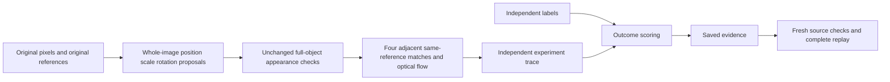

# Fraynix Agent Workspace — edition 152

**Rotation search without supplied return locations.** 2026-11-16.

[Previous: edition 151](README-151.md) · [All editions](docs/readmes/INDEX.md) · [Offline interactive guide](docs/readmes/152/index.html) · [Source and evidence](docs/readmes/152/verification.json)

{{FINDING}}

{{HERO}}

## What changed in the working app

The existing Spatial → Object identity panel now has **Rotation search · experimental**. Select an independently audited recording, choose **Search rotated returns**, and inspect a real Java-generated trace. The search scans the entire image at different positions, scales and orientations. It receives the original selected crop and any retained, already verified source appearances. **Returned target locations, visibility labels and predicted positions are not search inputs.**

The app runs the calculation in a single background worker and displays its current stage and image count. This avoids holding one browser request open for the entire replay. The app saves a separate deterministic experiment receipt. **Verify saved search again** reconstructs the complete trace from original pixels and checks every outcome. Restart does not confer trust on a saved result. Original source and implementation bytes are checked before and after computation; changed images, labels, source runs, code or forged outcomes are refused.

This is a working comparison capability, explicitly separate from the active observation tracker. `legacy-flow` remains the default. The old tracker/audit implementations and their evidence identities are unchanged. No experimental box is silently inserted into the persistent world, admitted as a new appearance, or used to authorize physical actions. This preserves the unified Java world, Game Lab, browser, creation tools and durable agent direction while testing a specific perception gap.

## How the Java search works

Java scans 24 initial orientations, from −180° to +165° in 15° increments, at three initial scales: 0.8, 1.0 and 1.2. It retains separated proposals per orientation and scale, then refines position, rotation and scale in five bounded stages. Joint horizontal/vertical moves help cross pixel-sampling plateaus. The search grid depends on reference size, with a 1–4 pixel step. This is an owned CPU algorithm; no new inference model, external vision library or GPU acceleration was added.

Every final match must retain correlation ≥0.94, RGB error ≤0.10, worst-quadrant error ≤0.14 and gradient agreement ≥0.85. The best disjoint competitor must remain more than 0.08 below the match. Four consecutive same-reference matches plus the existing optical-flow checks are required before output. A detected strong competing object remains a veto even after it disappears. Losing a match clears its confirmation history; forecasts and old confirmations cannot fill the gap.

The experiment fingerprint is intentionally conservative: changes anywhere in the retained observation, label or appearance namespaces require a new calculation and can invalidate an older experiment receipt. Originals remain saved. After restarting the app, select the original comparison and run the search again to reconstruct its result; progress tokens are not durable authority. Narrower evidence dependencies remain future work.

The reported angle is a **search hypothesis**, not a calibrated physical orientation measurement. Boxes are the image-axis bounds of oriented crops. The retained references stay immutable. An unseen identical substitution cannot be distinguished by appearance alone. Finite proposal search can still miss a competitor; these tests do not prove universal object identity.

## Results and complete request costs

{{TABLE}}

{{CAMERA}}

[Per-frame camera proposal coverage](docs/readmes/152/camera-search.json) distinguishes search overlap, strong appearance and actual accepted observations.

The generated sources are new, labelled software controls with original patterns and poses fixed before tracking. They are not footage, real-world measurements, or proof of general lighter recognition. Their labels were produced by the scene generator before any baseline or rotation search; the tracker receives none of those labels. The generator initially shared the pose-bound geometry helper; a separate Python calculation of all transformed corners verified every original label without using tracker output. Both complete traces and source hashes are retained.

The default tracker and rotation experiment are reported separately. The experiment's three-sample confirmation delay reduces initial recall. It is not a merged replacement for existing continuity. The two new rotated returns each contribute six correctly accepted post-cover samples, while the identical-copy case is withheld. A refusal is not successful recovery. No method has been promoted.

{{FRESH}}

Timing includes the app's Java request: original evidence verification, complete search, independent scoring, fingerprints and saving. It does not include source import, the preceding baseline run or screenshot capture. Cold restarted verification is reported separately in the linked receipts. These costs are offline experiment costs, not a real-time camera throughput claim. Edition 151's fast memoized *audit opening* is a different operation.

## CI finding and correction

The first check of predecessor CI found six failures, all in `ReplayEvidence151Test`: a guard rejected a Windows path whose real spelling differed from its supplied spelling. Windows short names can legitimately do that. The corrected code examines each actual path component for a symbolic link or reparse redirection before canonicalizing it. Ordinary short aliases work; redirected roots and ancestors remain refused. Every original byte-level evidence check remains in place.

Actual Windows tests exercised `C:/PROGRA~1` and a temporary junction. All six previously failing replay tests pass locally. Hosted CI status is recorded separately; local success is not represented as a hosted pass.

## Verification and honest failures

{{VALIDATION}}

{{ATTEMPTS}}

The app studies use isolated projects. They verify exact replay after an actual app restart, reject changed source bytes even with the same length and timestamp, restore the originals, compare the original evidence namespaces after releasing owned locks, and verify that the native world remains unchanged. The Java test also changes evaluation labels and proves the entire experimental trace stays identical; a self-checksummed forged outcome still fails replay.

Screenshots show the actual app and observed results. Source camera pixels, image descriptors, personal projects and model weights remain local. The public evidence receipts contain numerical traces and hashes; they do not replace the private originals required for source verification.

## Try it

1. Start the existing desktop app with its Java 21 installation and a separate review project. See [Windows launcher](scripts/Start-Agent-Workspace.ps1).
2. Open **Spatial → Object identity · occlusion & recovery**.
3. Select a completed, source-bound comparison. The original recording, labels and run must still verify.
4. Open **Rotation search · experimental**, then **Search rotated returns**. Leave the source files and world history stable during the run.
5. Review correct, withheld, wrong, hidden and competing-object counts together. Check the per-frame confirmation sequence and complete request time.
6. Use **Verify saved search again** to reconstruct the saved evidence. Keep the original project files to retain verifiability.

Experiments are bounded to the existing 96-frame import limit, six retained references plus the initial crop, and 64 saved experiment receipts. Interrupted work is not saved as completed evidence. Progress tokens are process-local, with one active calculation and four retained status records; after a process restart, start verification again from the original evidence. Saved files are private to the project in `rotation-experiments152/`. There is no automatic export, training promotion, category recognition or physical actuation.

## Source map and continuity

| Component | Responsibility |
| --- | --- |
| [RotationSearch152](workspace-engine/src/main/java/fraymus/workspace/RotationSearch152.java) | Whole-image pose search and unchanged full-object checks |
| [RotationReturn152](workspace-engine/src/main/java/fraymus/workspace/RotationReturn152.java) | Per-reference confirmation, optical flow and persistent ambiguity veto |
| [RotationExperiment152](workspace-engine/src/main/java/fraymus/workspace/RotationExperiment152.java) | Original proof verification, independent scoring, durable receipt and exact replay |
| [ReplayEvidence151](workspace-engine/src/main/java/fraymus/workspace/ReplayEvidence151.java) | Correct Windows alias handling; fresh byte fingerprints |
| [Comparison panel](workspace-desktop/renderer/association134-panel.js) | Working search and replay controls with measured results |
| [Actual app study](docs/publication152/study152.cjs) | Baselines, UI execution, restart and corruption checks |

[Complete source inventory](docs/readmes/152/file-inventory.json) · [Evidence archive index](docs/readmes/152/original-evidence.json) · [Obsidian note](docs/obsidian/160-rotation-search.md) · [Canvas](docs/obsidian/160-rotation-search.canvas) · [Implementation contract](docs/publication152/plan152.md)

## Next acceptance gates

1. **Fresh physical identity evidence and stable confirmation.** Diagnose why the returned source matches intermittently fail before changing any acceptance rule. Keep per-reference confirmation intact; do not combine unrelated single-frame successes into a false track. Record a clear original reference, complete cover, displaced and rotated return, and a separately visible lookalike. Include a wrong-object-only interval. Freeze source labels before evaluating. A second similarly colored lighter would be stronger than the black/red pair.
2. **Measured search coverage and cost.** Study where finite proposals miss either targets or rivals. Reduce work only with equivalent source and outcome checks, including restarts and growing evidence collections.
3. **Preserve useful continuity.** Compare a carefully gated combination with the existing tracker. It must add correct returns without overwriting verified incumbent measurements or increasing wrong-object acceptance. Do not merge a candidate merely because a generated example succeeds.
4. **Reconnect qualified observations to agent tasks.** Supply measured, predicted and unknown states distinctly to the persistent world and chat-driven artifact workflows. Keep numerical confidence and identity limitations visible. Physical action authority requires separate verification.

The destination remains one local, durable agent workspace: Java owns the environment, observations, execution, memory and checks; the desktop presents the world, browser, canvas and conversation. This edition improves an experimentally testable search capability. It does not establish consciousness, universal vision, general intelligence or recursive weight training.
