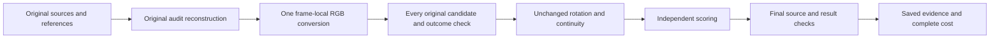

# Fraynix Agent Workspace — edition 156

**Rebuild the original proof with less repeated pixel work.** 2026-11-17.

[Previous: edition 155](README-155.md) · [All editions](docs/readmes/INDEX.md) · [Offline guide](docs/readmes/156/index.html) · [Validation](docs/readmes/156/verification.json)

{{FINDING}}

{{HERO}}

## Where this fits

Fraynix is a local agent workspace with a Java runtime, persistent world, physics, Game Lab, browser, creation canvas, durable goals and reusable procedures. Its direction remains one connected application: observe a situation, propose an action, perform it through a bounded tool and verify the outcome. The perception studies supply evidence for that workflow. They do not replace the broader application with a standalone tracker.

Reliable evidence can become too expensive to use if every opening takes minutes. Edition 155 reduced rotation-search cost while preserving complete reconstruction. Its measurements showed that original verification was then the largest remaining phase. Edition 156 targets that phase: the old full-object matcher repeatedly converted individual image pixels during its search. It can instead convert the current frame once and repeat exactly the same calculations over those values.

This is owned Java code with no new dependency, model download, GPU requirement or parallel search. Existing desktop, JSON, graphics and physics dependencies remain. The user selected recorded tests. No webcam was activated and no model invocation or weight training is claimed. Screenshots show the existing model selector as part of the actual app; it is not evidence that the selected model ran during this study.

## Use the new comparison

1. Open the existing workspace launcher with the intended private project. Keep each project under its own runtime owner.
2. Open **Spatial → Object identity · occlusion & recovery**. Select a completed labelled comparison whose original sources remain available.
3. Expand **Exact original verification · edition 156** and click **Compare original verification**. The app first checks the old audit, then computes the unchanged rotation and continuity comparison.
4. Read accepted, withheld and incorrect observations separately. A proposed image angle is a search hypothesis, not calibrated physical orientation.
5. Click **Verify saved result** to reopen a completed result. An unchanged same-process result can be reused only after fresh source and implementation byte checks.
6. Click **Replay every check** to force reconstruction. Restarting also clears the process-local cache, so the first verification after restart must reconstruct.

The original-verification, search and image-read costs are shown separately from total request time. Progress is not verified completion. Source changes, forged outcomes and missing history must refuse completion. Closing the owned worker interrupts its calculation; an interrupted calculation cannot produce a completed result.

The control is explicit. The default tracker remains `legacy-flow`. Older experiment controls and historical implementations remain available. This operation does not alter the native world, retain new appearances or authorize physical action.

## What changed in the original audit

The original 149 matcher samples both coarse and fine grids while testing positions, sizes, nearby refinements and competing matches. Its old sample routine calls the decoded image's per-pixel RGB conversion for every sample of every candidate. Many of those samples visit the same pixels.

`StructureReplay156` obtains one packed RGB array from the current decoded image, then uses the same sample coordinates and arithmetic. It retains every scale, position, candidate ordering, refinement, score accumulation, gradient, colour check, quadrant check, rival comparison and evaluation count. The array is released after the frame's search; it is not retained as an appearance, stored result or prediction. Supported images remain bounded to 1920 × 1080, so this additional array is bounded to about 8.3 MB.

Parent tracking and optical flow receive the original decoded image. Their rendering and interpolation paths do not change. The initial descriptor still comes from the original descriptor implementation. The new identity replay retains the old confirmation and motion logic, including its schema and complete frame contents, so it can be compared directly with the historical trace.

`OriginalAudit156` reconstructs original 149 audits using that exact replay. It verifies the saved audit checksum, input fields, completed run, source association, original tracker identity, retained reference provenance, complete dataset images, frame ordering, bindings, scores and replayed outcomes. It uses the original aggregate scorer. The final rebuilt audit must equal the complete saved audit, including negative outcomes and the original code identities. Other tracker policies still call their original verifier.

An old audit's code identity is not rewritten as a new one. The original classes remain unchanged, and the new calculation checks their recorded identity. The surrounding 156 evidence separately binds the current implementation bytes. This distinction preserves historical proof while making the new verification path reviewable.

The surrounding byte checks run before and after reconstruction. A changed image is not accepted because its length or timestamp looks familiar. A new checksum on a forged summary is insufficient: the summary must match the result recomputed from the original sources. Reference verification still rechecks the donor source and selected descriptors; the target's own predictions never become reference evidence.

## Source-labelled cases and observed outcomes

{{TABLE}}

The original column is the actual baseline run. The nested 153 column is the unchanged rotation-confirmation component within the combined experiment. Differences between those columns describe the existing continuity/return policy; they are not new perception gains introduced by 156. Mandatory optimization qualification requires complete reference/optimized evidence equality.

{{CAMERA}}

Seven new generated evaluation sources use previously unused fixed patterns with direction reversal, long full cover, a partial view before a full return, two separate loss/return episodes, a wrong pattern, a changed-quadrant near copy and simultaneous identical copies. Two separate stationary donor sources provide independently verified starting references. Their backgrounds differ from evaluation sources, and the verifier refuses shared image bytes. All source packs and labels are imported before any tracking. The donor runs use the existing appearance-continuity method; each evaluation runs original 149 with its retained reference, exercising the audit path optimized here.

The Java generator writes source geometry without calling a tracker. An independent Python calculation checks the schedules and bounding extents using half-extents rather than the generator's corner enumeration. Labels score the finished trace; they cannot supply return locations to the search. Partial-view labels describe the known full generated extent, not observed hidden pixels. These controlled images are not fresh physical footage.

Every withheld observation counts against recall. Competing-copy refusal can be correct without recovering the target. Behavioural targets and computational equivalence are reported separately, including any failures. A differently coloured red lighter is not a strong same-colour lookalike test, and invisible substitution between identical-looking objects remains unresolved.

## Complete costs and their limits

{{COST}}

The new generated request times are not directly comparable with edition 155's generated request times. These evaluations reconstruct original 149 runs with separate verified references; edition 155 used simpler legacy-flow baselines for its generated cases. The paired reference and optimized paths within this edition perform the same workload. The exposed camera remains the same source and audit used previously.

The paired measurement starts with new stores and forces the complete saved-result reconstruction. It includes original verification, reference checks, image bytes, full rotation search, refinement, confirmation, independent scoring, source fingerprints and saved-result comparison. Store construction, importing sources, producing the baseline tracking run, process startup and screenshot capture are separate costs. Reference and optimized order alternate. Every result must equal the same complete saved evidence; the entire project inventory must remain unchanged.

The exposed development probe is a different measurement. It compares only the original audit before reserved evaluation, not the complete 156 workflow. It is retained with its original log and result. The actual app's initial request, explicit replay and restarted request are also reported individually; they can differ from the command-line medians. No single best run establishes the release's cost claim.

Warm reopening is another distinct workload. The completed-result cache remains process-local, bounded to eight results and four MB of serialized content per result. Fresh byte comparisons bind reuse to the source history, images, labels, references and implementation. Returned data are detached. No persisted trust survives a restart. A fast warm read is not a live-camera frame-rate result.

## Verification

{{VALIDATION}}

New checks compare the complete original matcher across PNG/JPEG encodings, RGB layouts, alpha and grayscale/indexed images. Full enabled and monitor traces are compared through movement, prolonged loss, legitimate return and a different object. Complete audit tests cover original 149 and historical fallback, recomputed-checksum forgeries, same-size/time source changes, donor-image corruption, altered tracker code, changed reference provenance and modified run traces. The existing source and outcome refusal behaviour remains required.

Service checks cover cold, warm and forced verification, changed labels without changed predictions, detached cached results, missing-history refusal, bounded jobs and cancellation. Actual Electron/Java studies click the visible controls, take three warm readings per case, force reconstruction, close and restart their owned app, alter and restore a source byte, and compare the original evidence and native world afterwards. Private camera pixels are excluded from public screenshots and receipts.

{{ATTEMPTS}}

Hosted CI was checked before work and is reported separately at publication. The selected local regression does not represent a new run of every historical application feature. Original camera sources remain private and are required to reproduce their checks; public measurements cannot substitute for the images.

## Reproduce the checks

Use an isolated checkout with Java 21 and the existing desktop dependencies installed. From the repository root, the focused Java checks are:

```powershell
.\gradlew.bat --no-daemon --max-workers=1 :workspace-engine:test --tests fraymus.workspace.OriginalReplay156Test --tests fraymus.workspace.ContinuityExperiment156Test
npm --prefix workspace-desktop test
```

Those commands cover the 11 new Java checks and desktop suite. The separate 44-check regression selection is recorded in [the validation driver](docs/publication156/validate156.py); its archived XML joins the focused results without counting either invocation twice.

The [study driver](docs/publication156/run-studies156.py) records the sequential generation, independent source check, actual app comparisons and forced measurements. It expects the installed engine, compiled `HarderSources156` and `ReplayMeasure156` helpers, and a current [build stamp](scripts/Study-Build095.cjs). The validation driver documents those build commands. The frozen method lock must match before a study can run. Output directories and measurement files are deliberately one-use so a rerun cannot overwrite original evidence.

The generated source material is reproducible from the published generator. The camera study additionally requires the owner's private edition 150 project and its source images at the recorded local path; those images are not in Git. On another machine, adapt the private-source location in a separately identified study and record that difference. A public clone alone cannot reproduce the private camera result. Run heavy checks sequentially; the study does not require an active camera or a model inference call.

## Architecture, records and next work



| Responsibility | Source |
| --- | --- |
| Exact original full-object sampling | [StructureReplay156](workspace-engine/src/main/java/fraymus/workspace/StructureReplay156.java) |
| Complete original identity trace | [IdentityReplay156](workspace-engine/src/main/java/fraymus/workspace/IdentityReplay156.java) |
| Historical proof reconstruction | [OriginalAudit156](workspace-engine/src/main/java/fraymus/workspace/OriginalAudit156.java) |
| Byte-bound original-audit reuse | [ReplayEvidence156](workspace-engine/src/main/java/fraymus/workspace/ReplayEvidence156.java) |
| Full experiment and request costs | [ContinuityExperiment156](workspace-engine/src/main/java/fraymus/workspace/ContinuityExperiment156.java) |
| Frozen method and complete measurements | [Plan](docs/publication156/plan156.md), [measurement](docs/publication156/ReplayMeasure156.java), [qualification](docs/publication156/qualify156.py) |

The [offline guide](docs/readmes/156/index.html) offers case selection, actual screenshots, architecture links and searchable source inventory without external assets. The [Obsidian note](docs/obsidian/164-original-verification.md) and [canvas](docs/obsidian/164-original-verification.canvas) connect this phase to the broader application. Earlier numbered READMEs and frozen evidence remain historical records.

Next, use the measured phase costs to decide whether further reconstruction work earns its cost, then test qualified observations in durable world/browser/creation tasks. Those tasks must carry source identities, uncertainty and withheld observations into their decisions. Faster verification helps make evidence usable; it does not establish better physical accuracy, semantic recognition, general intelligence or consciousness.
