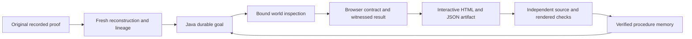

# Fraynix Agent Workspace — edition 158

**Verified observations become a durable connected task.** 2026-11-17.

[Previous: edition 157](README-157.md) · [All editions](docs/readmes/INDEX.md) · [Offline guide](docs/readmes/158/index.html) · [Verification](docs/readmes/158/verification.json)

{{FINDING}}

{{HERO}}

## Where the application is going

The original goal remains one local agent workspace with a persistent Java runtime: observations inform decisions, decisions use tools, and actual results determine whether a task succeeded. The game, physics environment, browser, creation canvas, data tools, memory and reusable procedures belong to that same application. Perception is useful when a task can use its evidence without losing its limitations.

The preceding editions concentrated on object continuity, re-entry, wrong-object rejection and the cost of reconstructing those results. Edition 158 reconnects that work to the application. One durable chat request now selects verified recorded evidence, checks its bound world, inspects an explicitly selected browser reference, creates an interactive report and verifies the actual rendered output before optionally retaining a reusable procedure.

This is a Java-authored procedure selected through chat. The study invokes no language model and makes no claim of new model learning. The registered path avoids unnecessary planning calls for a known task; open-ended reasoning remains a separate capability. No new external library, model download or GPU requirement is introduced. Reconstruction uses one bounded Java verification worker so status and cancellation remain responsive. The project retains its existing graphics, desktop, JSON and physics dependencies.

## One request, five checked stages

> Run a verified observation task: inspect its bound world, check the selected browser reference, create an uncertainty report, and save the procedure as observation-review.

1. **Observation.** Java first retains the durable request, then reconstructs the original experiment, verifies the recorded run, frame hashes, references, code identities and complete outcomes, then binds the task to those exact sources. It preserves accepted observations, withheld positions and separate continuous segments.
2. **World.** Java verifies the observation's unique body binding and original world source, then checks that the current world still matches. It records the actual native simulation position separately from image coordinates. Without a calibrated mapping, physical placement is refused. Inspection and explanation are supported.
3. **Browser.** The desktop visits the exact selected URL and independently reads the declared element and expected visible text. Its receipt is bound to the workflow, generation, effect and frozen contract. A reference page supplies browser evidence; it does not establish the physical object's identity.
4. **Creation.** Java writes an actual HTML/JSON artifact with an observation table, accepted/withheld filters, a frame scrubber, normalized image rectangles, source provenance, world decision and witnessed browser reference. Repeated continuation uses the same artifact identity rather than creating duplicates.
5. **Verification and memory.** The host operates the real controls and reads the rendered rows and SVG coordinates. Java compares all filtered source values, uncertainty labels, browser text, summary counts and four selected frame views against the original evidence. Only after those checks can the task complete and publish its procedure.

This edition's world stage is an inspection and action-admissibility decision. It does not move a simulated body from an uncalibrated camera estimate, let alone authorize physical hardware. That boundary is part of the functional result, not an unfinished action handler.

## Uncertainty travels with the task

The task retains normalized image coordinates and a **null positional error bound**. Error calibration, metric mapping, live pose and guaranteed physical identity remain false. A tracking rectangle describes image extent; its width is not a confidence interval. Recorded frame order is not current physical time.

When a position is withheld, its box and segment remain null. A later accepted return begins a new segment. The browser claim, world decision, saved report and reusable procedure retain those restrictions. No interpolation silently fills a lost object into the world. A rendered frame without an accepted position shows no object rectangle.

The verifier checks these distinctions as data and as visible output. Changing the report to claim an accurate physical position causes refusal, even when the rest of the report appears plausible. A missed or wrong browser check cannot be replaced with a model's assurance that it worked.


The frame control displays an accepted image rectangle above. For a withheld frame, the same control deliberately displays no position:


## Keeping old evidence valid without rewriting it

An original edition157 experiment includes a fingerprint of the surrounding source store and implementation. Adding an unrelated recording, or moving into this implementation, can change that fingerprint. Treating the old fingerprint as current would erase provenance. Rejecting every historical experiment forever would also prevent useful memory.

The new revalidation service keeps the original record and ID unchanged. After restart or changed source bytes, it runs a complete current reconstruction of the original audit and compares **every field except the derived experiment ID and whole-store fingerprint**. A new immutable lineage record links both records, their original/current fingerprints and the current task implementation. Changed original images, referenced appearances, trace or outcomes still refuse.

Warm process-local reuse has an eight-entry bound and performs fresh byte checks. It does not persist trusted execution across restarts. Lineage files are themselves hash-bound and checked against each task's retained history; changing or removing them refuses continuation. Existing experiment capacity remains 64; lineage history is bounded to 128 records, and one task retains at most 16 revalidations. Limits produce explicit refusals rather than silent eviction of evidence.

## Recovery and reusable skills

Add **review after world** to pause after the world decision. The request remains the same task with the same sources and stage history. A restart or explicit resume revalidates the current world and source evidence before proceeding. Stale host claims cannot acknowledge work in a later generation. A completed browser receipt remains a historical observation; reopening history does not pretend the page was freshly visited.

The existing workflow deadline is 1,200 seconds, workflow host claims expire after 60 seconds, and an interrupted workflow can resume at most three times. Complete reconstruction runs in one Java verification worker outside the workflow lock. Admission acknowledges promptly; status and cancellation remain available. The parent chat action keeps its existing 120-second lease. A resumed request must finish a new verification stage before any subsequent action. Late results from a cancelled task or prior generation cannot attach to another request. An active task refuses a changed evidence snapshot and requests explicit resume for full reconstruction; it does not undertake a long replay inside a short-lived browser claim. Source or world changes produce an explanation and preserve the stopped task. They do not silently substitute a different input.

A saved procedure retains its verified implementation and original successful workflow. Reuse requires an explicitly selected observation and browser contract; it does not inherit the previous recording or expected page text as if they were fresh. Inspection, retirement and reactivation use the existing procedure lifecycle and original-evidence checks. Retired procedures cannot run. A modified original artifact blocks evidence verification and reactivation.

## Try it in the application

1. Start the workspace with the intended private project and original observation files available. Keep the existing project's data separate from test copies.
2. Open **Spatial → Object identity · occlusion & recovery → Connected observation task · edition 158**.
3. Open a verified edition157 comparison above, or paste its full saved evidence ID. Selection is not verification; Java performs reconstruction when the task starts.
4. Enter a reference URL, a visible element selector such as `h1`, and the exact expected visible text. Use a page you intend the agent to inspect.
5. Click **Prepare connected chat request**, review the request, then click **Start task**. Optionally add **review after world**.
6. Use the task history's **Resume** control after an interruption. Inspect the browser result, uncertainty statement, image-frame controls and original source rows in the completed report.
7. Reuse the saved procedure with a different explicit source and browser contract. Its report must be calculated and independently checked again.

The default tracker remains `legacy-flow`. No historical tracker class or earlier numbered documentation is changed. Physical accuracy remains unresolved; this phase makes existing evidence useful and auditable without promoting it to ground truth.

## Measured application results

{{TABLE}}

{{VALIDATION}}

The sources are two exposed generated recordings from edition157 and the exposed edition150 camera recording retained in157. These are fresh task executions on known material, not newly captured footage or unseen tracking evaluation. The browser page is a labelled local HTTP fixture rendered by the real browser, not an internet research claim. It establishes the application's real browser interaction and rejection behavior under a controlled reference.

The camera input's original tracking summary remains 34/42 correct visible observations, 8 withheld, zero wrong overlaps and zero accepted hidden frames out of 30. The report includes the full ordered trace, including hidden-frame withholding; its total withheld count therefore differs from the visible-only tracking summary. No new physical accuracy improvement is claimed.

Elapsed task costs include verification and host interaction; the interrupted cases additionally include deliberate pauses, restart and/or refusal recovery. They are descriptive end-to-end costs, not throughput benchmarks. Saving and later checking a procedure adds original-evidence work. Report repetition, final restart verification and corruption probes are recorded separately from completion time. This edition does not claim that connecting tasks makes perception faster.

{{ATTEMPTS}}

## Tests and reproduction

```powershell
python -X utf8 docs/publication158/validate158.py
```

The driver runs eight selected Java test classes, all desktop unit checks, builds the installed Java runtime and stamps it for actual application testing. It uses one heavy job at a time. Output paths are one-use so prior results are preserved. The method lock records the final implementation and study before evaluation.

The [app study](docs/publication158/study158.cjs) exercises actual visible preparation and chat controls, forced Java interruption, same-task recovery, wrong browser text, real report interaction, procedure reuse and lifecycle, cold verification, and same-size/same-time image corruption. Original source projects are inventoried before and after. Public screenshots show app/report data without private camera pixels. Tests use separate project copies and never alter the user's live world.

Private recorded inputs are not in Git. Reproducing the exact camera result requires the owner's recorded source project; a public clone alone is insufficient. A new machine should supply its own clearly identified source paths and record a new study. The [evidence index](docs/readmes/158/original-evidence.json) preserves original test logs, app receipts and failed development attempts. [Hosted CI](https://github.com/eyeoverthink/Fraynix-Agent-Workspace/actions) is reported separately from local validation.

## Architecture, files and next gates



| Responsibility | Source |
| --- | --- |
| Historical proof reconstruction and lineage | [ObservationEvidence158](workspace-engine/src/main/java/fraymus/workspace/ObservationEvidence158.java) |
| Source binding, uncertainty and world decision | [ObservationTask158](workspace-engine/src/main/java/fraymus/workspace/ObservationTask158.java) |
| Working artifact and independent comparator | [ObservationReport158](workspace-engine/src/main/java/fraymus/workspace/ObservationReport158.java) |
| Durable stages, claims, recovery and procedure retention | [WorkflowRunner](workspace-engine/src/main/java/fraymus/workspace/WorkflowRunner.java) |
| Chat routing and ownership | [Domain044](workspace-engine/src/main/java/fraymus/workspace/Domain044.java) |
| Real browser and report observations | [Desktop host](workspace-desktop/observation-task158.cjs) |
| Complete application study | [Study](docs/publication158/study158.cjs) |

The [offline guide](docs/readmes/158/index.html) provides screenshots, results, architecture links and searchable source inventory. The [Obsidian note](docs/obsidian/166-observation-tasks.md) and [canvas](docs/obsidian/166-observation-tasks.canvas) map the same implementation. Earlier editions and frozen assets remain intact.

Next: make the observation-to-task decision more useful with calibrated coordinates and conservative error bounds on an independently measured source. First verify the mapping and stale-frame handling; then test bounded world actions against unchanged native physics and independent outcomes. Separately measure the repeated reconstruction cost across longer connected tasks before adding another cache. Broader semantic interpretation, open-ended model planning and hardware action each need their own evidence and acceptance gates. Persistent memory, real execution and useful learning remain the destination; neural activity, fluent text or a completed demonstration alone do not prove general intelligence.
