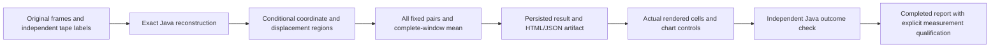

# Fraynix Agent Workspace — edition 160

2026-11-17 · Independent recorded-motion checks · Local Java · Defaults preserved

[Previous edition 159](README-159.md) · [Offline interactive guide](docs/readmes/160/index.html) · [All editions](docs/readmes/INDEX.md) · [Development plan](docs/publication160/plan160.md)

{{FINDING}}

{{HERO}}

## The application and its direction

Fraynix remains one local agent workspace. Java coordinates persistent tasks, observations, memory, skills and outcome checks; the desktop presents the browser, creation canvas, spatial world and Game Lab. Its physics runtime lets the system propose experiments, observe actual simulated outcomes and retain verified procedures. The destination is an integrated agent that observes, reasons, creates, acts and learns from measured results.

Edition 158 connected verified recorded observations to world inspection, browser checks and working artifacts. Edition 159 connected measured plane coordinates to bounded simulation actions and saved procedures. Edition 160 checks the measurement side of that bridge: how far the tracked object actually moved relative to independently labelled tape marks, and whether the declared geometric allowance contains that displacement.

This release adds a working Java evaluation view and durable report jobs. It does not add a chat route, run model training or promote a new tracker. Existing chat/world/browser/creation workflows remain available; the new measurement evidence is the prerequisite for later action selection. No new dependency, GPU requirement or model download is introduced. Existing desktop, JSON, graphics and native physics dependencies remain in use.

## What now works

1. Select a completed recorded movement episode with independent endpoint labels.
2. Freeze the trial, original calibration, labels and exact-frame fingerprint. Copied footage under a different ID cannot count as another episode within the job.
3. Reopen every source image and metadata record, check their bytes, ordering, timestamps and dimensions, and reconstruct the original tracker, reference guard and motion filter from the original seed.
4. Compare the reconstructed observations with the original numeric observations. Only wall-clock processing duration is excluded. A different compiled observer identity is explicitly retained as a new linked reconstruction; the historical proof is not relabelled.
5. Project the localization region into world X/Z metres. Compare every fixed start/end pair and the complete-window mean with the separately labelled tape displacement.
6. Persist results and create real HTML/JSON files. The desktop exercises all three chart modes and reads actual table cells, source labels, uncertainty labels and SVG coordinates. Java independently checks them against the retained calculation.
7. Reopen or cold-restart the job and recheck every original source, exact artifact and outcome. A failed measurement gate can yield a completed, truthful report; it cannot become a successful physical measurement claim.

## The independent reference and error calculation

The original 041 episode records the black lighter moving from the tape's **4-inch mark to its 8-inch mark**. The user confirmed the motion and the fixed start/end frames were independently inspected for visibility and mark placement. All eight starting frames and all eight ending frames remain in the calculation; there is no favourable-window selection. These eight paired observations are **one correlated episode**, not eight independent physical trials.

The original calibration fits a **10 × 8-inch visible rectangle within the 12 × 12-inch cutting mat**, with separate check intersections and tape marks. Native placement of the plane is declared. The tape supplies the displacement length; the plane fit supplies orientation, not a replacement measured length.

For each accepted raw tracked point, Java projects the four corners of an explicit pixel allowance through the original homography. It adds the original annotation allowance, maximum independent grid residual, independent tape-length discrepancy and original relative-scale allowance. Regions outside the measured polygon or across a projective horizon are refused. Each displacement interval is the end interval minus the start interval. The reference itself has a separately declared displacement allowance.

The report retains:

- Nominal tape displacement containment and containment of its entire declared reference region.
- Actual displacement error and the radius of the conditional rectangle.
- Eight fixed paired rows, the complete-window mean and explicit missing measurements.
- Separate original observer, current observer and reconstruction identities.
- Original labels, evaluations and frame hashes.

Default evaluation allowances are **2 pixels**, **3 mm annotation**, **3 mm displacement-reference**, **10 mm maximum error**, and **40 mm maximum radius**. These new evaluation settings do not change tracker or native-controller defaults. They cannot shrink the original calibration's annotation allowance. Repeated frames do not earn a square-root-of-sample-count reduction. All-missing errors and radii remain **unknown**, never zero.

The intervals are conditional geometric allowances, **not calibrated coverage probabilities**. Unknown target height, parallax, lens distortion outside the checked region, calibration changes and exact mark placement remain limitations. Passing one historical episode does not prove general physical accuracy or authorize hardware motion.

## Actual results

{{TABLE}}

{{VALIDATION}}

The camera row is one exposed historical recording. The reverse-motion and changed-camera rows are separately labelled generated image sequences, not fresh camera footage. Their reference motion comes from integer drawing coordinates rather than tracker predictions. Every sequence is replayed through the real observer. The changed-camera case deliberately violates the old reference and must withhold measurements; a verified report of that refusal is the correct result.

Job span includes complete source checks, actual report inspection, repeated verification and deliberate restart where used. It is an end-to-end execution span, not a throughput benchmark or a controlled speed comparison. Reconstruction timing is also retained in the [comparison data](docs/readmes/160/comparison.json).

{{ATTEMPTS}}

## Review it in the app

Use JDK 21 and the project's established Node.js setup. [Start-Agent-Workspace.ps1](scripts/Start-Agent-Workspace.ps1) prepares the Java engine and verifies the desktop dependency cache. `-PrepareOnly` prepares without launching; `-Offline` requires already-cached dependencies. Use an isolated project for copied evaluation evidence; do not start a new build against an active older database.

1. Open **Spatial → Independent motion checks**.
2. Click **Load recorded trials**. Select one to four completed movement trials with independent labels. A new empty project has no such trials; it does not invent examples.
3. Inspect **Declared evaluation limits**, then click **Evaluate original footage**.
4. Select the retained evaluation. An interrupted job offers **Resume reconstruction**; resuming reconstructs the same frozen sources.
5. Click **Open and verify report**. Inspect the error/radius chart, switch all three modes and read the full fixed-pair table.
6. Return to the panel and use **Recheck original evidence** after completion. This reruns the checks rather than trusting a cached success label.

The report is a local versioned artifact with `index.html` and `accuracy.json`, visible in the creation canvas. Its scope is explicit even when measurement gates pass. The UI does not activate the webcam or move any object.

## Persistence, limits and refusal

Jobs use one reconstruction worker, at most 16 retained evaluations, one to four distinct episodes per job, a 240-second bound per reconstruction/verification, and at most three explicit resumes. Source bindings are saved before execution. Stop and generation checks prevent superseded work from publishing. Original records use checksummed atomic writes; a restart marks running work interrupted.

Completion requires independent rendered-report acknowledgement. Source changes, altered labels, image corruption, changed observations, artifact edits and differing evaluator identities are refused. The app trial alters an original transition frame in its private copy: the completed report must fail verification, then verify again only after the exact original bytes are restored. Originals in the user's source directory remain untouched.

A report can be complete while measurement gates fail. This distinction prevents “the workflow ran” from being confused with “the camera is accurate.” Current-position authority, object identity after occlusion, ground contact and hardware actuation remain separate requirements.

## Tests, evidence and reproducibility

- [Original sequence reconstruction](workspace-engine/src/main/java/fraymus/workspace/PlaneReplay160.java)
- [Independent displacement and bounds](workspace-engine/src/main/java/fraymus/workspace/PlaneAccuracy160.java)
- [Durable evaluation store](workspace-engine/src/main/java/fraymus/workspace/PlaneAccuracyStore160.java)
- [Report and independent comparator](workspace-engine/src/main/java/fraymus/workspace/PlaneAccuracyReport160.java)
- [Actual desktop chart observations](workspace-desktop/accuracy160.cjs)
- [Regression checks](workspace-engine/src/test/java/fraymus/workspace/PlaneAccuracy160Test.java)
- [Locked application study](docs/publication160/study160.cjs), [method lock](docs/PLANE_ACCURACY_160_LOCK.json)
- [Validation receipt](docs/readmes/160/verification.json), [original logs and attempts](docs/readmes/160/original-evidence.json), [source inventory](docs/readmes/160/file-inventory.json)

Run the focused sequence with `python -X utf8 docs/publication160/validate160.py`. Its output paths deliberately refuse overwriting retained receipts. The application study creates a separate project copy and refuses reuse of an attempt directory. Original private camera images are excluded from Git; the owner's exposed-camera trial requires those originals. Generated test definitions and all source code are public. Screenshots show actual app controls and numeric evidence, not private camera pixels.

Hosted [GitHub CI](https://github.com/eyeoverthink/Fraynix-Agent-Workspace/actions) is checked first and again before publication, and reported separately from local checks. At the pre-publication check, the latest hosted runs were still in progress; local success is not a claim of green hosted CI. Historical numbered READMEs and snapshots remain frozen; current source and originals are inventoried and verified from fetched Git blobs.

## Next phases

1. Test separately labelled physical episodes spanning new directions, distances and viewpoints. Keep episode-level coverage separate from correlated frame counts; do not tune and claim validation on the same footage.
2. Recover from camera/reference changes through a new measured calibration and new source binding, preserving the refused old result.
3. Add a separately tested smaller, single-marker native control path. Edition 159 still uses its inherited two-body controller and explicit return marker; do not silently change that engine identity.
4. Admit moving-object observations to short, reversible simulation actions only when current calibration, identity and remaining correction authority justify them.
5. Measure full task cost and compare remembered procedures against simple control. Retain improvements only when independent task outcomes earn them.

The direction remains a unified persistent Java agent with observations, memory, experiments, tools and verifiable outcomes. This release strengthens the measurement evidence that future decisions can rely on.
