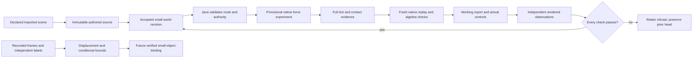

# Fraynix Agent Workspace — edition 161

2026-11-17 · Small-object control · Independent motion evidence · Java-owned execution

[Previous edition 160](README-160.md) · [Offline interactive guide](docs/readmes/161/index.html) · [All editions](docs/readmes/INDEX.md) · [Implementation and qualification plan](docs/publication161/plan161.md) · [Blender assessment](docs/publication161/blender161.md)

{{FINDING}}

{{HERO}}

## Where the application is going

Fraynix is one local workspace for an agent that observes, plans, creates, acts and checks what actually happened. Java owns durable computation and accepted state. The desktop hosts the browser, creation canvas, spatial views, chat and Game Lab. Physics provides an executable environment for proposals and experiments; memory preserves verified procedures and their evidence. The objective remains an integrated agent, with useful capabilities judged by outcomes rather than by its description of itself.

The recent sequence makes the observation-to-action bridge more explicit. Edition 158 used verified recorded observations in connected world, browser and creation tasks. Edition 159 mapped measured image-plane coordinates to bounded simulation actions. Edition 160 evaluated recorded displacement against separately labelled tape marks. Edition 161 adds a smaller action domain that can operate on one object, without inheriting the old two-body/20 cm constraints or weakening that older controller.

The new small-object operation is an explicit experimental control inside Spatial. Existing chat and saved-procedure workflows remain available. This edition does not silently route camera observations or free-form chat into the new controller. That later integration needs verified small-object position, geometry, contact and uncertainty. A simulation proxy is not a measurement of the lighter, and a correctly verified native move is not proof of physical precision.

## What works in this edition

1. Create a clearly labelled 5 cm, 40 g test block in the existing app, or select a compatible imported JSON scene.
2. Keep its authored starting scene separate from the accepted evolving scene. One world can retain successive verified moves.
3. Request a target X/Z position in metres. Java validates the current revision, dimensions, mass, force reserve, floor bounds, obstacles and declared coordinate allowance before starting.
4. Execute lift, translation, lowering and release through actual native force and torque. Full integration ticks, contacts, work and pose histories are retained. The controller does not teleport the body or overwrite its velocity after initialization.
5. Stop or interrupt an unaccepted attempt and resume from the same unchanged accepted starting state. An interrupted attempt cannot advance the world. This bounded recovery repeats provisional computation; it does not claim an identical continuation of hidden native solver caches.
6. Open a real HTML/JSON report in the creation canvas. The host exercises the replay slider and reads actual path geometry and displayed results. Java checks those observations against the original trace and an independently rerun native experiment.
7. Advance the accepted world only after all required checks pass. A later task rechecks the complete accepted ancestry. Changed source state, plans, reports or stale revisions refuse completion.

The existing recorded-motion evaluator remains available alongside this path. Its original frames, calibration, labels and observation reconstruction are rechecked. Private camera images remain outside Git; published captures show reports and controls.

## The small-body domain

| Property | Declared limit |
| --- | --- |
| Dynamic bodies | Exactly one upright box |
| Side lengths | 5–15 cm on each axis |
| Mass | 20–200 g |
| Environment | Flat floor at Y = 0, with static box obstacles |
| Horizontal move | 2–40 cm per request |
| Lift ceiling | 60 cm |
| Force / torque | Bounded by the frozen request; insufficient lift reserve is refused |
| Collision margin | Smaller of 2 mm and 2% of the smallest side |
| Endpoint acceptance | At most 4 mm error and 1 degree orientation error |
| Settled acceptance | At most 0.02 m/s and 0.05 rad/s, with actual floor contact |
| Coordinate allowance | Explicit 0–30 mm route expansion; not a measured probability |
| Work limits | Eight worlds, twelve retained jobs, three resumes per job |

The app still uses its existing Bullet integration through Java. No new physics framework, Blender installation or model download is required. Java owns the new planning, persistence, verification and report generation; native physics remains an existing dependency. “Ground up” describes the owned application logic, not an assertion that the JVM, desktop, JSON or physics libraries no longer exist.

## Actual native results

{{NATIVE_TABLE}}

These values compare simulated body positions with declared simulation targets. Small numerical endpoint errors are not real-camera accuracy figures. The obstacle case tests a fixed overhead corridor; it does not establish arbitrary obstacle navigation or grasp planning. The changed-report case is an intentional refusal, not a successful motion acceptance.

The first task is interrupted after native execution and before report acknowledgement. A cold process reopens the same pending result, independently reruns it, checks the rendered artifact and only then accepts revision 1. The second task begins from the actual accepted first outcome and produces revision 2. Verification after another cold restart reconstructs the chain again. Force, work and per-tick pose checks remain in force throughout.

## Independent motion labels and the physical limitation

{{MOTION_TABLE}}

The physical source is the **existing, exposed four-inch lighter movement**, with independently labelled start and end tape positions. Its eight fixed start/end pairs are one correlated episode. They are not eight independent trials, and re-running the source does not make it new footage. The original cutting mat is 12 × 12 inches; the existing calibration uses the marked visible 10 × 8-inch rectangle with independent check points.

The two new generated sequences vary movement length and direction. Their endpoint labels come from integer target geometry used to construct the images, separately from the tracker. This checks the measurement machinery under controlled conditions. It does not replace real footage, parallax assessment or independent instrument measurements.

The user explicitly selected existing recordings and left new physical validation pending. No webcam was started. Error allowances remain conditional geometric bounds, not calibrated confidence probabilities. Target height, perspective effects and exact physical mark alignment remain unresolved. Existing defaults and all earlier failed/promoted evidence remain unchanged.

## Using it

1. Start the normal workspace with its existing launcher and your own project. Use a separate project for experiments; do not silently share a live project's database with another checkout.
2. Open **Spatial → Single-object motion**.
3. Choose **Create labelled 5 cm test scene**, or select a suitable existing import and choose **Use this import**. Unsupported geometry is refused with a reason.
4. Enter the target X and Z in metres and the declared coordinate allowance. Choose **Check route** before **Run bounded move**.
5. Inspect the retained attempt. **Stop**, **Resume** and **Cancel** apply only in their allowed states; completed history is immutable.
6. Choose **Inspect report & accept verified result**. This opens the actual replay and runs the source, native and rendered-outcome checks. A failed check leaves the accepted head unchanged.
7. Scrub the recorded motion. Inspect the numeric evidence when needed. **Recheck originals** reconstructs the completed evidence and world ancestry.
8. For recorded data, open **Independent motion checks**. Select existing completed, independently labelled movement trials, evaluate, then inspect the actual report. New empty projects contain no private camera recordings.

## Architecture



```text
workspace-engine/src/main/java/fraymus/workspace/
  SmallBody161.java       domain, route and accepted-state constraints
  SmallPhysics161.java    actual bounded native integration
  SmallVerify161.java     every-tick motion, wrench and contact checks
  SmallStore161.java      durable attempts, replay and world revisions
  SmallReport161.java     working report and independent comparator
workspace-desktop/
  small161.cjs            actual Chromium outcome observations
  renderer/small161.js    controls inside the existing Spatial view
docs/publication161/
  plan161.md             fixed scope and qualification gates
  blender161.md          source-backed assessment and later phases
```

The new state lives in its own experimental domain so older physics identities and procedures remain valid on their original terms. This is not a second standalone application. Its views, reports, imported scenes and storage use the existing workspace. State updates are checked and written atomically; a failed write rolls memory back to the durable original. A saved checksum mismatch refuses loading. These integrity checks are not a defense against an attacker who controls all local code and evidence files.

## Would Blender help?

Yes, primarily as an **optional external authoring, rendering and synthetic-data tool**. Its separation of authored and evaluated state is also a useful architectural reference. The edition 161 implementation uses our existing Java code; no Blender source is copied. [Blender dependency-graph documentation](https://docs.blender.org/api/current/bpy.types.Depsgraph.html)

An important limit: Blender's rigid-body implementation also uses Bullet. Cross-checking the same declared setup there can reveal exchange or configuration mistakes, but agreement is not independent real-world validation. [Official Blender rigid-body source](https://github.com/blender/blender/blob/main/source/blender/blenkernel/intern/rigidbody.cc)

Free/open source does not mean license-free. Before copying or distributing Blender-derived implementation, examine the applicable licenses; translating code into Java does not remove its obligations. Blender's software license is distinct from artwork created with it. [Blender license explanation](https://www.blender.org/about/license/)

The [full assessment](docs/publication161/blender161.md) records the inspected source blobs and a phased exchange proposal. No Blender import/export capability, embedded window, renderer or new dependency is claimed in this release.

## Validation, development and publication

{{VALIDATION}}

{{ATTEMPTS}}

The qualification method and gates were committed before the application trials. All retained attempts remain available with source and evidence hashes. The app tests use actual Java execution and Chromium controls; unit receipt fixtures are clearly distinguished from the application witness. There are no live-model calls or training claims in this edition. The selected regression scope does not revalidate every historical application feature.

See [verification summary](docs/readmes/161/verification.json), [application evidence](docs/readmes/161/application-study.json), [motion study](docs/readmes/161/motion-study.json), [original receipt index](docs/readmes/161/original-evidence.json), [source inventory](docs/readmes/161/file-inventory.json) and [Obsidian map](docs/obsidian/169-small-object-motion.canvas). Hosted CI is recorded separately from local checks; an in-progress run is not reported as passed.

## Next phases and acceptance gates

1. **New physical labels:** obtain separately measured displacement, full occlusion and return episodes when the user is ready. Freeze labels and thresholds before evaluation, preserve every missing/wrong result, and test repeatability across changed conditions.
2. **Small-object observation binding:** identify the actual controlled point and its height/contact assumptions, retain calibration/source identity, and propagate the full coordinate region into the bounded single-object plan. Refuse stale, ambiguous or oversized uncertainty.
3. **Durable chat and reusable procedure:** connect that qualified binding to one explicit chat request using the existing goal/skill ownership model. Require successful outcomes and fresh-source revalidation before saving a reusable procedure. Do not treat this manual experiment as already qualified automatic agency.
4. **Optional Blender exchange:** first round-trip stable IDs, metres, axes, transforms and declared physics metadata on simple scenes. Then add controlled rendered variations and replay video exports. Keep the Java runtime authoritative and keep rendered appearance distinct from measured physics.
5. **Measured improvement:** compare success and complete task cost against the simpler existing route. Promote defaults only after reserved cases justify it. Retain rollback and the original evidence.

The immediate value is concrete: the agent platform has a smaller, independently checked action domain and another set of motion-evaluation evidence, while its physical uncertainty stays visible. The wider goal remains an integrated system that can form an idea, test it in its environment, inspect the result, retain what works and explain the limits honestly.
