# Fraynix Agent Workspace — edition 162

2026-11-17 · Recorded object coordinates · Conditional uncertainty · Durable Java tasks and skills

[Previous edition 161](README-161.md) · [Offline interactive guide](docs/readmes/162/index.html) · [All editions](docs/readmes/INDEX.md) · [Acceptance plan](docs/publication162/plan162.md)

{{FINDING}}

{{HERO}}

## The application and its direction

Fraynix is a local workspace in which an agent can observe, propose work, execute registered actions, inspect actual outcomes and retain verified procedures. Java owns task state and computation. The desktop supplies the browser, creation canvas, chat, Game Lab and spatial interfaces. These are connected working surfaces within one application. The long-term purpose is useful agency: a request should lead to a checked result that survives interruption and remains explainable afterward.

The game and physics runtime is part of that purpose. It supplies a place to test proposals against an explicit state, integrate motion, record failures and compare predicted and actual outcomes. The runtime is useful precisely because actions have consequences that can be checked. A fluent answer alone cannot establish that an object moved or that a generated artifact works. Recorded observations add a separate source of evidence, with their own limitations.

Edition 158 connected recorded observations to world, browser and creation work. Edition 159 introduced calibrated plane references for the older native controller. Edition 160 evaluated displacement using independently supplied endpoint labels. Edition 161 added a single-object controller for a smaller authored domain. Edition 162 connects the last two pieces to the existing Java workflow supervisor, durable chat and saved-procedure registry. It is an integration milestone, not a claim that the remaining perception or physical-accuracy questions have been solved.

## What changed

One explicitly prepared chat request now performs a complete sequence:

1. Reconstruct the original recorded movement, including every stored image, frame metadata, calibration, tracker output, reference guard and filter result.
2. Re-evaluate its displacement against the separate fixed start/end labels. The existing measurement gates must pass.
3. Select an independently labelled, accepted endpoint frame. A predicted point, hidden target or transition without an independent endpoint label cannot become the target.
4. Project that recorded object centre onto the measured plane. Carry the full conditional coordinate region and its enclosing radius into the existing small-object controller.
5. Validate the authored destination, accepted revision, route clearance and the combined coordinate/execution allowance.
6. Persist a workflow-owned native child and its world reservation together. Execute actual bounded simulated forces, lift, translation, lowering, release and settling.
7. Independently replay the original native motion and inspect both the original native report and the new source-bound report in the actual canvas.
8. Check the actual endpoint against the frozen combined allowance before accepting one world revision. Save the requested procedure only after the workflow evidence is complete.

The small-object physics algorithms, numerical integration and original acceptance checks remain unchanged. No external service, new model, camera capture or hardware controller is activated by this workflow. Existing tracker and controller defaults remain intact. Users select this experimental path explicitly.

## Try it in the app

First create or select a compatible small world under **Spatial → Single-object motion**. The labelled example supplies an upright 5 cm, 40 g box on a flat floor. Imported scenes must satisfy the same domain checks. Importing a photograph does not infer a mass, collider or object height.

Open the measured-alignment area and expand **Recorded object → durable small-object task · 162**. Load existing movement recordings and small worlds. Choose the recorded trial, one of its independently labelled endpoint frames and the destination world. The input panel expresses allowances in millimetres; Java retains the numerical contract in metres.

Use **Check recorded target** to inspect the original frame hash, projected X/Z region, coordinate radius and route. This performs verification but does not move the simulated box. **Prepare chat request** selects those explicit inputs and fills the chat composer. Sending the prepared request starts the durable workflow:

> Run a recorded small-object action using the selected recorded object coordinates; verify the result and save the procedure as recorded-small-object.

Add “review before action” to pause after the source check. The existing Mission view exposes the retained task, its stages and Resume/Stop controls. After a restart, explicitly resume the same request. For another task, choose fresh source and destination bindings, then ask:

> Reuse recorded-small-object v1 for the selected recorded small-object action.

The Skills interface retains the same inspection, retirement and reactivation mechanism used by other verified procedures. Reactivation rechecks the original evidence. Reuse is not permission to reuse an old location or stale world revision.

## What these coordinates mean

The selected point is the tracked image centre projected onto the calibrated mat plane. The destination is an **authored simulation proxy**. Its height, box dimensions and mass come from the scene. They do not come from a physical measurement of the lighter. Object thickness, parallax, camera calibration residuals and mark alignment remain relevant physical limitations.

The radius includes the pixel-localization rectangle projected through the plane transform, the original annotation allowance, independent grid residual, tape discrepancy and distance-dependent scale allowance. The radius is not divided by the number of correlated frames. It is not presented as a statistically calibrated confidence interval. A passed displacement evaluation establishes the stated result for that episode; it does not prove absolute object pose accuracy or performance on new footage.

Before action, the selected coordinate radius plus the requested execution allowance must fit the declared total. The route includes that coordinate expansion. Before acceptance, the actual simulated planar endpoint error plus the coordinate radius must also fit the total. An honest result therefore carries two distinct facts: the simulation endpoint was checked, and its relation to the physical source remains conditional on the recorded-plane assumptions.

| Boundary | Current contract |
| --- | --- |
| Observation | Completed recorded movement with original frames and independently labelled endpoints |
| Measurement gate | Eight usable paired samples; all eight reference regions contained; existing error and width limits |
| Selected target | One visible, labelled, accepted measured endpoint; no prediction substituted |
| Destination | One authored upright 5–15 cm box, 20–200 g, on a flat floor |
| Movement | Existing 2–40 cm horizontal move, bounded lift and obstacle clearance |
| Coordinate radius | At most 30 mm; source-derived, never silently reduced |
| Execution allowance | At most 4 mm; a stricter requested limit is enforced |
| Combined allowance | At most 34 mm; checked before action and against actual outcome |
| Recovery | Same durable parent and child; provisional computation may repeat, accepted movement does not |
| Work limits | Existing 20-workflow, 32-procedure and small-world/job capacities remain in force |
| Physical authority | None; no live camera pose or hardware movement |

## Measured application results

{{RESULT_TABLE}}

These rows are complete application task spans, including source checks, native execution, report inspection and skill publication. The interruption case also includes the deliberate restart and review. They are not controller-only timing benchmarks. Reusing the same exposed recording at different endpoints does not create another independent physical episode. Different box geometry is an authored simulation change.

{{VALIDATION}}

The application study uses the visible chat composer, Java workflow engine, real native integration, actual rendered controls and cold verification. The new Java unit tests use clearly labelled software host receipts for targeted refusal and recovery checks; those fixtures are not claimed as browser evidence. Local test results and hosted CI status are reported separately. The published evidence records the source and method used for each attempt.

{{ATTEMPTS}}

## Persistence, recovery and evidence

The workflow stores its source identity, selected frame, region, destination state and plan before action. The child task records its parent identifier and source digest in the same atomic checkpoint as the small-world reservation. If a process ends between child creation and the parent recording its next stage, recovery finds that existing child rather than creating another one.

The native run is provisional until independent checks pass. The original native report remains a separate artifact. The source-bound report adds recorded coordinates, region limits and budgets while preserving the actual motion replay. The host opens and checks both artifacts. Java reconstructs the native result, checks visible report observations and applies the source/error contract before accepting the new state.

A crash after the world accepts a result but before the parent finishes cannot justify another movement. The child remains completed; replay verifies its history and the parent continues verification and publication. Cancellation preserves already accepted history. An altered source or report is refused rather than relabelled as fresh evidence. Old implementation-bound proofs remain historical: changing an implementation identity does not make an earlier result a proof of the new implementation.

Saved skills are procedures with prerequisites, actions, success checks and recovery, backed by a completed source workflow. They retain policy and evidence, not hidden authority over future sources. Fresh trial, frame, destination revision and hash are mandatory. The original source workflow and any retained ancestry are checked before reuse or reactivation. This is durable procedural memory; no LLM weight training is claimed.

## Implementation map

```mermaid
flowchart LR
  Frames[Original frames and independent labels] --> Source[Java source reconstruction]
  Source --> Region[Recorded plane point and conditional region]
  Region --> Parent[Durable Java workflow]
  Parent --> Child[Stable small-body child]
  Child --> Native[Unchanged native controller]
  Native --> Reports[Original and source-bound reports]
  Reports --> Checks[Fresh replay and actual canvas checks]
  Checks --> World[One accepted world revision]
  World --> Skill[Verified retained procedure]
  Skill --> Fresh[Fresh source and destination selection]
  Fresh --> Parent
```

| Component | Responsibility |
| --- | --- |
| [RecordedSmall162.java](workspace-engine/src/main/java/fraymus/workspace/RecordedSmall162.java) | Source reconstruction, bounds, stable child ownership and endpoint contract |
| [WorkflowRunner.java](workspace-engine/src/main/java/fraymus/workspace/WorkflowRunner.java) | Durable stages, leases, recovery, original evidence and skill publication |
| [RecordedReport162.java](workspace-engine/src/main/java/fraymus/workspace/RecordedReport162.java) | Source-bound interactive artifact and independent observation comparator |
| [Domain044.java](workspace-engine/src/main/java/fraymus/workspace/Domain044.java) | Registered Java chat routing and completion evidence |
| [recorded162.js](workspace-desktop/renderer/recorded162.js) | Explicit source, endpoint, destination and budget selection |
| [workflows.cjs](workspace-desktop/workflows.cjs) | Actual browser/canvas inspection for the Java-owned workflow |

The [offline guide](docs/readmes/162/index.html) includes real screenshots, result filtering, module links and the complete source inventory. [Original evidence](docs/readmes/162/original-evidence.json) links retained checks and attempts. The [Obsidian map](docs/obsidian/170-recorded-object-workflows.canvas) places the source, controller, reports and memory in one navigable view. Historical numbered READMEs and their frozen snapshots remain intact.

## Next steps and acceptance gates

The next useful improvement is to measure the complete cost of this connection across more source episodes and longer accepted-world histories. Repeated reconstruction is deliberate verification work; reducing it requires byte-bound reuse that preserves every source and outcome check. A cache hit alone is not evidence that a current source is valid.

Fresh independently labelled physical motion remains pending by the user's choice. When available, it should test new placements, directions, heights and occlusions, with references kept separate from tracker outputs. Absolute contact-point calibration and object geometry require their own evidence before these coordinates can support stronger physical claims.

For the connected application, the next phase should preserve the same authority structure while extending requests: observe a specific object, choose an appropriate action, produce a useful artifact, and compare expected with actual results. A planner may choose among registered procedures; it must not invent a passing verifier or erase a failed attempt. The useful direction is a more capable unified agent with retained, inspectable results, rather than a larger collection of disconnected demonstrations.

The current result is a real source-to-simulation workflow with durable chat and procedural memory. Its physical interpretation remains bounded and explicit. Progress means improving useful completion, recovery, accuracy and cost under independently checked conditions.
