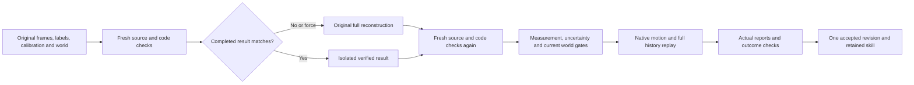

# Fraynix Agent Workspace — edition 163

2026-11-17 · Complete workflow costs · Verified recording reuse · Growing world histories

[Previous edition 162](README-162.md) · [Offline guide](docs/readmes/163/index.html) · [All editions](docs/readmes/INDEX.md) · [Acceptance plan and amendments](docs/publication163/plan163.md)

{{FINDING}}

{{HERO}}

## Where this fits in the application

Fraynix connects observation, simulation, browser and creation surfaces through durable Java tasks and verified procedures. The purpose is an agent that completes useful work, checks what happened and retains a way to repeat it with fresh inputs. The physics runtime supplies consequences that can be measured. The browser and canvas supply working surfaces. Java owns task state, source bindings, recovery and acceptance.

Edition 162 connected recorded object coordinates and conditional uncertainty to the smaller controller, durable chat and saved skills. Edition 163 asks whether that connection remains practical as sources change and the accepted world history grows. A faster isolated tracker is not enough if source reconstruction, restart, history replay, report checking and skill publication dominate the whole request.

This edition measures those complete requests. It reduces repeated recording reconstruction through a bounded memory of already verified computation. It also fixes a genuine display incompatibility exposed by the longer history. The numerical controller, movement limits, physics integration and outcome thresholds are unchanged. The report change has a new implementation identity; historical proofs are not relabelled as current evidence.

## What is implemented

The recorded-object route can reuse a completed reconstruction only within the current Java process and only after fresh evidence checks. Four entries are retained, each at most 2 MB. Restart discards this memory. Neither a saved skill nor a persisted successful task is a cache entry.

Every access checks the original trial and independent labels, registration checksum, image and metadata bytes, recalculated calibration, historical world binding and defining code containers. It reads the evidence before and after obtaining the result. File size and timestamps cannot establish a match. A missing source is refused before older store accessors can initialize an empty replacement. Linked paths are refused. Changed inputs trigger a full reconstruction or an explicit refusal. Any failure clears the retained entries.

The first use executes the original `PlaneReplay160` reconstruction. A later exact match may return an isolated copy of that completed result. The returned JSON cannot change the retained value. A changed code inventory, explicit full reconstruction, cold start or eviction causes original computation again. The original tracker, reference guard, filter and independent displacement evaluation remain in force.

This reuse has a deliberately narrow boundary. Java still rechecks measurement gates, chooses a labelled accepted endpoint, computes its uncertainty region, checks the current world and route, executes actual native motion, replays native results and history, inspects both rendered reports, checks endpoint error and verifies retained-procedure ancestry. No physics result, accepted-world revision or browser observation is inferred from the recording cache.

## What the longer baseline revealed

The published edition162 baseline was retained unchanged. Its first itinerary correctly refused a third move shorter than the controller's 20 mm minimum. The comparison itinerary was corrected to use the farther labelled endpoint before final comparisons; the movement threshold was not relaxed.

The next baseline completed three moves, then refused a report after the deliberate restart. The final sample time was 4.675 seconds. Java formatted that label as **4.68**, while Chromium's `toFixed(2)` displayed **4.67**. The actual DOM diagnosis established this difference. The numeric pose was not evidence of a stale artifact, and the refusal was not bypassed.

The report now carries canonical Java-formatted sample labels. The independent verifier still reconstructs expected labels from the numeric rows and compares the actual displayed text, selected pose, path, axes, source and native outcome. Halfway-time rendering fixtures exercise 1.005, 2.675 and 4.675 in actual Chromium. Altered labels and poses remain refused.

The failed published baseline is reported as a failed complete workflow, not used as a successful speed comparison. The final full-replay and reuse runs both use the same corrected implementation, isolating the cost of reuse from the display correction.

## Complete workflow measurements

The fixed itinerary has four successive actions in one authored world:

1. Move to the camera recording's labelled end point and save procedure v1.
2. Reuse v1 with the generated shorter-forward recording's start point; save v2.
3. Reuse v2 with the generated longer-reverse recording's start point; save v3.
4. Reuse v3 with the camera recording's start point, pause before action, abruptly end Java, restart, resume the same task and save v4.

The world reaches four accepted revisions with exactly four native children. Each reuse gets a fresh source, frame and world binding. Each completed task also receives a separate archive verification. Source uncertainty and authored geometry remain explicit throughout.

Two pairs run in alternating order: full A, reuse A, reuse B, full B. All runs use the same sources, two Java processors and a 768 MiB Java heap. The sources are **one exposed historical camera episode and two existing labelled generated sequences**. Repetition is not additional physical evidence.

{{PAIR_TABLE}}

{{RESULT_TABLE}}

Task totals include preparation, durable execution, report checks, retained-skill publication and an additional original archive verification. Task4 includes the deliberate restart. Startup and complete four-task session time are also retained. Fixture copying and post-study corruption/visual tests are excluded; cold verification is measured separately. These are small local measurements, not a statistical guarantee for other machines or workloads.

The comparison checks exact reconstructed sources, coordinate regions, plans, all native samples and integration records, forces, contacts, verification metrics, outcomes and observed report values. Only newly generated scene/object/job IDs and their state hash receive fixed aliases for comparison. No numerical simulated result is discarded to obtain equality. [Detailed comparison](docs/readmes/163/comparison-evidence.json).

## Verification and retained attempts

{{VALIDATION}}

{{ATTEMPTS}}

Unit checks cover warm/cold/forced reconstruction, mutable-result isolation, bounded eviction, changed code inventory, missing state, source corruption with the same size and timestamp, metadata and label changes, changed tracker results, calibration damage, historical-world damage and a mutation between snapshots. Actual app runs separately exercise the visible chat composer, source controls, native controller, both reports, saved versions, abrupt interruption, recovery, corruption refusal and cold verification.

The new cost panel reports recording-verification counters for the current Java process. They reset after restart and are separate from durable evidence. Its byte count covers explicit frame/code reads performed by the reuse layer, not all application I/O. Source-check and reconstruction durations are not whole-task benchmarks. Complete timings come from the outer workflow study.

These explicitly prepared requests made zero model calls. This is Java procedural execution through chat, not a claim of model inference, LLM training, autonomous physical recognition or general reasoning improvement. Local checks and hosted CI status are recorded separately.

## Using it

Open **Spatial → measured alignment → Recorded object → durable small-object task · 163**. Load the recordings and small worlds, select a labelled endpoint and destination, inspect the allowances, then prepare and send the chat request. Existing tracker and controller choices remain unchanged.

> Run a recorded small-object action using the selected recorded object coordinates; verify the result and save the procedure as recorded-small-object.

For reuse, select fresh inputs and request the retained name/version. Add “review before action” to pause before the simulated move. Resume the same task after an interruption. A new task is not a substitute for verifying an existing accepted revision.

**Show verification cost** displays current-process counts and source timing. **Reconstruct full recording** forces original computation and target checks without executing a move. For a controlled comparison, starting Java with `FRAYNIX_WORKSPACE_RECORDED_REPLAY=full` disables reconstruction reuse. Removing that setting restores the bounded verified reuse path. Both modes retain all source and outcome conditions.

The recorded point still represents the tracked image centre projected onto a measured plane. The box's geometry, height and mass remain authored. Conditional allowances are not calibrated confidence probabilities. This workflow does not move hardware or establish live lighter pose. Fresh physical validation remains pending by the user's choice.

## Implementation and evidence map

| Component | Responsibility |
| --- | --- |
| [RecordedReplay163.java](workspace-engine/src/main/java/fraymus/workspace/RecordedReplay163.java) | Bounded exact reconstruction reuse, fresh source/code checks and process counters |
| [RecordedSmall162.java](workspace-engine/src/main/java/fraymus/workspace/RecordedSmall162.java) | Existing source-to-controller contract, uncertainty and endpoint gates |
| [WorkflowRunner.java](workspace-engine/src/main/java/fraymus/workspace/WorkflowRunner.java) | Durable ownership, original outcome verification, retained skills and cost access |
| [SmallReport161.java](workspace-engine/src/main/java/fraymus/workspace/SmallReport161.java) | Consistent visible labels; unchanged exact observation comparator |
| [recorded162.js](workspace-desktop/renderer/recorded162.js) | Integrated source selection, full reconstruction control and cost display |
| [study163.cjs](docs/publication163/study163.cjs) | Actual app comparison with growing history and restart |
| [compare163.py](docs/publication163/compare163.py) | Exact numerical/observed comparisons and complete cost calculations |

[Original evidence index](docs/readmes/163/original-evidence.json) · [Validation](docs/readmes/163/verification.json) · [Obsidian map](docs/obsidian/171-recorded-workflow-costs.canvas) · [Full source inventory](docs/readmes/163/file-inventory.json). All previous numbered editions and snapshots remain frozen.

## Next gates

Measure what remains expensive: native-history replay, report opening, retained-procedure ancestry and restart. Extend the complete-task comparison toward longer mixed sequences, more source episodes and tighter resource allowances before selecting another optimization. Any reuse must remain tied to current source bytes, implementation and independently checked outcomes.

Physical accuracy is a separate frontier. New independently labelled motion, different placements and heights, contact-point calibration and occlusion tests are still required before stronger physical claims. Faster verification does not supply that missing evidence.

The application direction remains one connected local agent: observe, propose, act, inspect, recover and retain useful procedures. This phase improves the practical cost of that loop while keeping the reasons for accepting a result inspectable.
