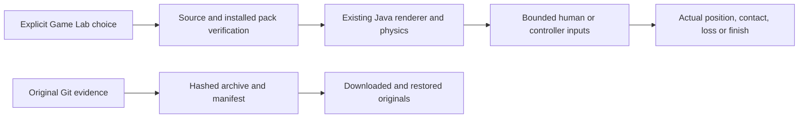

# Fraynix Agent Workspace — edition 167

**2026-11-18 · Original playable content, preserved engine checks, retrievable history.**

[Previous edition](README-166.md) · [Edition history](docs/readmes/INDEX.md) · [Offline guide](docs/readmes/167/index.html) · [Architecture renewal](docs/ARCHITECTURE_RENEWAL_PLAN.md)

The application remains one integrated local agent workspace: observations, a persistent world, durable tasks, browser/canvas tools and evidence-backed results. This edition adds **Relay Garden**, an original playable content pack for the existing Java Game Lab, and verifies the next historical archive batch. It does not introduce another numbered runtime subsystem.

## Play Relay Garden

Open a saved workspace, choose **Game**, then **Play Relay Garden**. The robot starts on a modular garden deck. Cross two gaps and reach the lit beacon. The movement buttons and Jump send bounded inputs to the same player and collision solver used by the existing engine. AI play uses the unchanged default controller. Pause, Reset and Close runtime remain available. Reset restores the checked starting level; it does not overwrite the user's authored scene.

The pack is explicit. The existing default original-level button, historical construction procedures and saved projects retain their previous behavior. All rendering stays inside the application through the hidden native renderer; no separate editor window is required.


These are actual Java/Electron application captures from 2026-11-18. The scene is generated game content, not camera evidence. No model inference, physical-camera observation or improved real-world accuracy is claimed by this release.

## What is original, and what is reused

`RelayGardenGenerator` draws the robot, animated poses, deck tiles, planter, beacon and sky with Java graphics operations. It synthesizes mono PCM sound cues and constructs a new serialized level from explicit component values and stable identities. It reads no existing image, sound recording or level. The repository contains both the generator and its reproducible outputs, with a manifest identifying every content byte.

The existing renderer, player, animation system, collision solver and bounded input interface are reused. A named `FallBoundary` component gives this level a real loss condition below the deck. Existing levels do not acquire that component automatically. Sound names such as `mario_die` remain compatibility keys used by inherited code; the corresponding WAV is a newly synthesized tone, not a copied recording.

The integrated runtime normally disables audio. Tests decode the original non-silent WAV data; screenshots do not establish speaker playback. The new PCM loader supports those bounded mono cues when the existing audio device is enabled.

Original content provenance does not relicense inherited code or clear all historical assets. The older Mario-style content remains available for compatibility and historical verification. Full replacement of that content and a project-wide distribution license remain separate shipping work.

## Verification and actual outcomes

@@VALIDATION@@

@@PLAY@@

Both source and installed pack bytes are checked before launch and reset. Same-size asset corruption with a restored timestamp and a changed source level are rejected. A request cannot supply an arbitrary replacement path. Actual runtime observations list the original content resources used; the new course loads no legacy image or sound asset.

The native test records both success and failure: gap-aware inputs reach actual finish contact; a no-jump run falls into the gap and loses. The real app test checks manual movement, the existing controller, visible pixels, reset, a complete app restart and retained starting identity. These checks demonstrate this bounded course, not universal game generation or general planning.

@@IDENTITY@@

## CI diagnosis and development attempts

The initial CI check found both edition 166 publication runs failed before Java execution. Their archive test rejected the Windows runner's linked temporary parent. Restore now resolves and pins the physical parent once and performs all writes through that path. It still requires a new destination, rejects destination links/overwrites and traversal, checks original byte and canonical hashes, and selects exactly one provider. An actual Windows junction regression passes.

The first new junction test had an incorrect PowerShell argument invocation; it was fixed using separate environment values. The first native course trial reached the beacon, but its failure check exposed that the inherited player kept falling without entering its death state. The new level explicitly includes `FallBoundary`. The next launch correctly rejected that type until it was registered in the existing component allowlist. The corrected real runtime passes. Logs and earlier results remain in the evidence archive; none are represented as successful trials.

@@CI@@

## Next verified archive batch

@@ARCHIVE@@

The batch is bound to the separately pinned edition 166 historical catalog and original Git commit. Every selected file is restored from Git, packed, restored through the archive provider, and compared byte for byte. The published evidence asset is then downloaded and the nested historical batch restored again against the original Git blobs. Corrupt and missing providers refuse without silently falling back to Git. A checked second copy is retained on another local volume; that is not an off-site disaster-recovery guarantee.

No frozen history was removed from Git, and no remote history was rewritten. This remains a reversible migration. Hashes and catalogs identify missing evidence; they cannot recreate its bytes. A complete cutover still requires all retained evidence to have durable, tested providers.

[Download manifest](docs/readmes/167/original-evidence.json) · [Archive results](docs/readmes/167/archive.json) · [Validation](docs/readmes/167/verification.json) · [Exact source inventory](docs/readmes/167/file-inventory.json)

```powershell
python scripts/evidence_archive.py download --manifest docs/readmes/167/original-evidence.json --archive evidence167-local.zip
```

Choose a new download path. The download verifies every original member. The enclosed `legacy163.zip`, catalog and manifest provide the historical batch; `scripts/history_archive.py --help` explains restoring selected paths into a new destination. The downloaded batch receipt records comparison to the original Git objects.

## Architecture



The content profile is a named capability. The server retains shared authentication, admission and active-task ownership checks. Legacy behavior remains default. The archive fix changes path resolution, not authority or evidence acceptance.

## Build and inspect

Use JDK 21 and the repository's Gradle wrapper. Build with `gradlew.bat prepareGameRuntime115 :workspace-engine:installDist`, install locked desktop dependencies with `npm ci` in `workspace-desktop`, then run `npm start` there. Use a separate test project for experiments. The long-history checkout still requires Windows long-path support.

Regenerate the original pack into a new directory using `gradlew.bat generateRelayGarden -PrelayOutput=build/my-original-pack`. Generation refuses an existing destination. The reproducibility test compares every generated file with the checked-in pack. A constructed level is not accepted as playable merely because its JSON parses; the retained native and actual-app tests establish this course's outcomes.

## Next complete slices

1. Extend the original pack to pickups, hazards and varied geometry, with measured playtests and explicit compatibility for existing procedures.
2. Add more historical archive batches and independent retrieval checks before any separate clean-repository cutover.
3. Continue named-domain extraction and retire superseded selection paths behind tested replay compatibility.
4. Improve the everyday Chat, Mission timeline and Evidence layout, then test a genuinely fresh installation.

The destination remains an integrated local agent that observes, acts and checks consequences in its persistent world. Original content makes that world more independently maintainable. This edition does not claim full asset replacement, a new trained model, improved tracking, a complete architecture rewrite or a signed installer.
