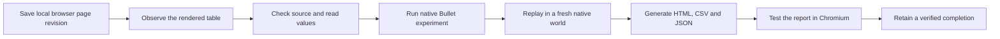

# Fraynix Agent Workspace · Edition 172

[Edition 171 and Game Lab playtesting](README-171.md) · [Interactive offline guide](docs/readmes/172/index.html) · [Edition history](docs/readmes/INDEX.md)

One chat request now reads an editable local browser page, runs and replays a native physics experiment, and creates a checked report inside Fraynix. Java keeps progress at each boundary and verifies the saved result when you reopen it.

## Run the experiment

1. Choose **Ramp input** in the live browser panel. Enter the slope, friction, gravity, mass and duration. **Save page and prepare chat** creates the versioned local page and fills in **Run the local ramp experiment.**
2. Choose **Start task**. Fraynix reads the table in Chromium and uses those verified values in the Java physics engine. Select **Pause after reading the table** when preparing the task if you want to inspect that checkpoint first.
3. Follow the work in **Mission**. If interrupted, click **Resume mission**. The source revision stays pinned.
4. Open the saved result, toggle the replay on the chart and optionally download the trace as CSV or the full evidence as JSON. **History** can recheck and reopen an archived result.

This command supports the typed ramp page authored inside Fraynix. It can run with model discovery disabled and the browser in offline mode. For a test launch with those switches, follow the [edition 171 PowerShell instructions](README-171.md#run-the-mission). On an existing installation with local models, the same exact command still follows the Java route.

## What Java checks

- The five visible fields and values must match the persisted page revision. Java checks the page and input hashes and binds the installed physics engine. Page text supplies data to the experiment.
- Each independent simulation starts with the same ramp settings. It runs at 240 Hz from 0.25 to 2 seconds, samples every 12 ticks plus the exact final tick, and compares sampled position, velocity, orientation, projected downhill travel and contact count. Position and velocity must agree within 0.0001 m and 0.0001 m/s respectively. These are simulation replay tolerances.
- Java checks the report files against regenerated bytes and keeps the actual canvas test results. The report's replay toggle must show and hide the comparison trace.
- A newer input revision blocks unfinished work. A completed mission retains its original browser evidence and can reopen the pinned older report. The underlying scene is isolated from active user-authored experiments.

## Verification

@@VALIDATION@@

@@RESULTS@@

Two forced Java process stops tested separate recovery boundaries. The first preserved the pinned browser observation before native execution. The second preserved both native runs and the written artifact before the canvas checks. Resume retained the four completed stage receipts and the original simulation session IDs. An edited browser DOM and a stale paused source both failed before simulation. The archived original still opened after the page advanced to a newer revision.

[Browser input](docs/readmes/172/ramp-input.png) · [Paused checkpoint](docs/readmes/172/ramp-checkpoint.png) · [Changed input](docs/readmes/172/ramp-changed-input.png) · [Reopened result](docs/readmes/172/ramp-reopened.png) · [Verification data](docs/readmes/172/verification.json) · [Evidence bundle](https://github.com/eyeoverthink/Fraynix-Agent-Workspace/releases/tag/evidence-172)

## Next

Register these stages so future deterministic requests and optional local planners can compose them through the same Java contracts. Prove that with a second local source format, a fresh experiment and an independent artifact verification after restart. [Implementation and next gates](docs/publication172/plan.md)
