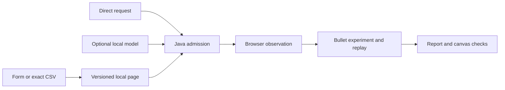

# Fraynix Agent Workspace · Edition 173

[Edition 172 and the original browser-to-world path](README-172.md) · [Offline companion](docs/readmes/173/index.html) · [Edition history](docs/readmes/INDEX.md)

The same Java procedure now accepts either ramp values entered in Fraynix or a local CSV. Both sources pass through a versioned browser page, native world execution, a fresh replay and a tested report. An installed local model can select this registered procedure when you ask it to. The direct route still works with model discovery disabled.


## Run a CSV experiment

1. In **Live browser → Ramp input**, choose **Import one local CSV** or enter the values in the form. The CSV preview shows the typed values Java read. Open **Procedure stages** to inspect the five steps.
2. Choose **Save page and prepare chat**, then **Start task**. Use **Use saved page** to run the existing source revision again.
3. Select **Pause after reading the table** to keep a checkpoint before any simulation. Use **Resume mission** if Java stops during the experiment. The latest stage with a saved receipt determines the work that resumes.
4. Open the verified report to toggle the fresh replay, download the sampled motion, or download the **original inputs** when they came from a CSV.

A CSV must have one header and one data row, in UTF-8 and under 8 KiB. The columns can be in any order. Angle is in degrees, gravity in metres per second squared, mass in kilograms and duration in seconds. Friction is unitless. For example:

```csv
angle_deg,friction,gravity_mps2,mass_kg,duration_s
35,0.025,10.9,1.45,0.83
```

With a model selected, check **Ask the selected local model to choose the procedure**, then start **Plan the local ramp experiment.** This is a single registered procedure with one source and the requested pause setting. Java validates that choice, pins the source and owns all later stages. The agent can complete the direct request without an installed model.

## What is shared



Each stage checks the expected previous output and saves its own receipt. The Java verifier reconstructs the sequence, source bytes, replay and saved report. The CSV path preserves the original uploaded bytes, including its ordering and line endings. A page whose stored CSV was changed is refused. Reports for form inputs retain their earlier format.

## Verified in the app

@@RESULTS@@

@@TESTS@@

[Screenshot of CSV input and the catalog](docs/readmes/173/ramp-csv-import.png) · [Recovered checkpoint](docs/readmes/173/ramp-csv-checkpoint.png) · [Local model result](docs/readmes/173/ramp-planner-verified.png) · [Exact outcome summary](docs/readmes/173/verification.json) · [Original test evidence](https://github.com/eyeoverthink/Fraynix-Agent-Workspace/releases/tag/evidence-173)

## Next

Give the planner two validated procedures with different outputs, then test whether it selects the one the user meant and whether its extra latency is justified. [Implementation and acceptance gates](docs/publication173/plan.md)
