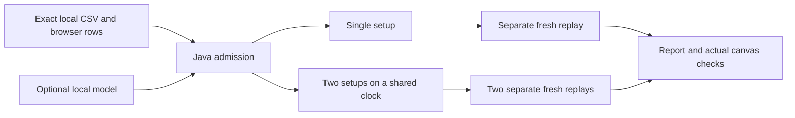

# Fraynix Agent Workspace · Edition 174

[Edition 173 and CSV input](README-173.md) · [Offline routing and motion guide](docs/readmes/174/index.html) · [Edition history](docs/readmes/INDEX.md)

Fraynix now offers two verified local ramp procedures. **First setup** produces one trajectory and an independent replay. **Compare both setups** measures two trajectories on the same clock, independently replays each one and reports the signed difference in travel.


## Use the new comparison

1. Open **Live browser → Ramp input**. Import a UTF-8 CSV with either one or two setups. To compare, give both rows the same duration.
2. In **Report**, choose **Compare both setups**, then **Save page and prepare chat → Start task**. The direct chat command is **Compare the local ramp setups.**
3. To let a local model choose the procedure, select a model and use **Plan a local ramp task:** followed by your request. For example, ask which setup travels farther on the saved timeline. Java binds the input and owns every verification step.
4. After an interruption, choose **Mission → Resume mission**. The paired report lets you hide or show the second trace and download measurements, original inputs and the verified evidence.

```csv
angle_deg,friction,gravity_mps2,mass_kg,duration_s
38,0.04,9.81,1.2,0.85
18,0.31,9.81,1.2,0.85
```

A one-row input can still run the single experiment. Comparisons require the second setup. A model can ask for clarification when the desired outcome is unclear or the source is incomplete. When you explicitly ask for a comparison with one setup, Java asks for the second setup before calling a model.

## What is verified



Browser rows must match the pinned source revision. Each simulated setup has its own source identity and native session. The paired verifier checks all four session IDs, both traces at 240 Hz and their retained samples, the shared clock and the signed difference. The artifact is regenerated from the checked data. Chromium must show the correct measurements and exercise the actual second-trace control before completion.

## Desktop and local-model results

@@RESULTS@@

@@TESTS@@

[Paired inputs](docs/readmes/174/paired-ramp-input.png) · [Recovered checkpoint](docs/readmes/174/paired-ramp-checkpoint.png) · [Model-selected comparison](docs/readmes/174/paired-ramp-model-routing.png) · [Missing-input clarification](docs/readmes/174/paired-ramp-missing-input.png) · [Verification receipts](docs/readmes/174/verification.json) · [Original test evidence](https://github.com/eyeoverthink/Fraynix-Agent-Workspace/releases/tag/evidence-174)

## Next

Expand the held-out requests to multiple domains and measure when local model routing earns its cost. Use the same typed admission, recovery and evidence gates. [Implementation and acceptance gates](docs/publication174/plan.md)
