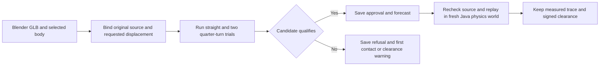

# Doorway carry and independent checks

2026-11-24 · Edition 218

## Evidence from the inverse review

Edition 217 could approve nearby copies whose colliders cleared each other even while the rendered rims crossed. A pending approval also reset on desktop restart. The doorway exercise tests a moving version of that clearance problem and gives pending carry proposals their own restart path.



## Verification contract

- The controller evaluates straight, +90° and −90° orientations. Native Bullet bodies move through the existing gripper constraint while Java applies bounded yaw control during the carry. It restores the original yaw near the destination, lowers and releases.
- A conservative separating-axis clearance is computed independently for both collider boxes and oriented visual bounds. Commanded intervals include a translation and rotation allowance between ticks. Actual pose clearance is checked at every native tick. The route must meet the 8 mm clearance gate under both checks.
- Solver impulse and penetrating pair geometry establish unexpected contact. The first contact carries the object, obstacle, tick and phase. Expected floor support is checked from the solver normal and impulse during the settle.
- Final position error must be within 20 mm and angular error within 2°. Java checks 240 released ticks and at least 120 consecutive supported ticks within the terminal speed limits.
- The original GLB bytes, canonical source, selected object, displacement, policy and native candidate evidence are bound to the saved review. A valid carry keeps a distinct fresh run. The original imported definition can be reopened from the same project. Java locates the newest committed review without a desktop checkpoint. Switching views clears approval until the reviewed source is shown again.
- This procedure certifies the tested motion family. A refusal means every supported candidate missed a check. Other trajectories could exist. The visual envelope is a conservative bound on the surface and can refuse a passage that a tighter geometry test might allow.

## Reproduce

```text
./gradlew :workspace-engine:installDist
./gradlew :workspace-engine:test --tests '*SpatialCarryTest' --tests '*SpatialPropExchangeTest' --tests '*SpatialExchangeTest'
node workspace-desktop/test/spatial-doorway-integration.cjs build/doorway218
```

Use `gradlew.bat` on Windows. The checked fixtures were authored with Blender 5.3.0 and are loaded directly by Java, so the test and the workflow run offline without Blender installed. The [fixture authoring script](../../workspace-desktop/test/spatial-doorway-blender.py) can recreate their geometry.

## Follow-on experiment

Create two original props with the same overhead footprint and distinct heights. Compare a planned calibrated second view with a repeated overhead view on held-out Blender scenes, then check a physical prop independently with calibrated scale and a ruler. Carry dimension error and uncertainty into the collider review. Keep a required face unresolved until the evidence supports a bound.
