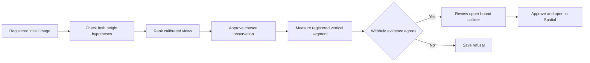

# Choose a camera view and verify a height bound

2026-11-24 · Edition 219

## What Java checks

1. Parse the source package and match six fixed opaque color landmarks in the calibration image for each candidate. Fit the orthographic projection from four 3D points. The other two points check that fit.
2. Use the initial observation to check that both height hypotheses fit the visible top marker. Rank candidates by the pixel separation left after the declared allowance. Candidate and withheld target pixels are decoded only after you approve the selected observation.
3. Use the approved image to estimate a registered vertical segment. Reject missing, clipped, disconnected or incomplete markers and changed landmark positions. The marker centroid is registered 35 mm above the surface. Fit a range using an assumed 0.8 px centroid allowance, propagated through the calibration fit and enlarged by the calibration residual.
4. Check the estimated marker projection from a distinct, withheld viewing angle. Require a reprojection error of at most 2 px. Refuse if the check disagrees or the height range is too wide for this collider procedure.
5. Bind the original package, exact plan, verified interval and collider definition by hash. Re-evaluate the observation on collider approval. The imported scene retains the source reference and rechecks its receipt and original bytes when opened.



## Package

A study uses the `fraynix.metric-height-study-v1` JSON format with base64 PNG images. Include one initial view, two to five candidates and one withheld view. Each view pairs a calibration image with an observation at the same pose and image scale. The coordinates are in metres in a right-handed frame with Y up. The base anchor rests at Y=0. Use six distinct solid 50 mm sphere landmarks in the order defined by the authoring script. Use a solid magenta 48 mm sphere centered 35 mm above the target surface. The width and depth of the prop come from the supplied footprint. The source packages have a 1.2 MB cap.

A second angle checks geometric agreement given the registered input. The workflow assumes the same marked object is seen in both images. The probability of error, physical readout accuracy, and robustness under arbitrary occlusion were outside the Blender study. A physical study needs independently measured landmarks, separately measured target height, camera calibration, controlled visibility and a marker that uniquely identifies the target.

## Reproduce

```text
./gradlew :workspace-engine:installDist
./gradlew :workspace-engine:test --tests '*MetricHeightStudyTest'
node workspace-desktop/test/height-study-integration.cjs build/height219
```

Use `gradlew.bat` on Windows. The application and tests use the checked images offline without running Blender. The [Blender authoring script](../../workspace-desktop/test/height-study-blender.py) can recreate the fixtures. [Independent Blender mesh references](../../workspace-engine/src/test/resources/spatial/height-studies/independent-mesh-measurements.json) are only read by the test. [Desktop evidence](../readmes/219/evidence.json) records both measurements, the refused observation and the imported collider.

## Next acceptance test

Collect a fixed, calibrated image pair and an independent physical ruler measurement. Include a second similarly shaped object, a fully visible target, and a partially covered target. Measure what the declared interval does under each condition before allowing any physical-world claim.
