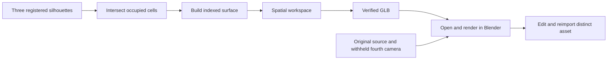

# Reconstruct editable geometry from images

2026-11-24 · Edition 220

Three transparent PNGs cover the declared cubic search volume from the positive world axes. X looks along negative X with screen right along negative Z. Y looks down with screen right along positive X. Z looks along negative Z with screen right along positive X. Each view uses the same square framing, centre and scale. The [Blender fixture script](../../workspace-desktop/test/spatial-reconstruction-blender.py) shows all three camera bases.

Java intersects occupied pixels by projecting candidate grid-cell centres into each registered silhouette. It extracts the exterior faces, shares indexed vertices, reprojects the result into each input, and refuses a disagreement beyond the threshold. The triangle mesh flows through the existing Spatial asset and verified GLB exporter. Original image bytes and the reconstructive evidence are hashed and checked when reopened. The exported Blender edit becomes its own distinct authored asset.



## Reproduce

```text
./gradlew :workspace-engine:installDist
./gradlew :workspace-engine:test --tests '*SpatialReconstructionTest'
node workspace-desktop/test/visual-reconstruction-integration.cjs build/visual-reconstruction
```

Use `gradlew.bat` on Windows. Set `FRAYNIX_TEST_BLENDER` to the Blender executable to author new inputs and run the independent round trip with the withheld view and surface checks. Without that setting the desktop test uses the bundled images and exercises the Java path. Recreating the fixture can produce different encodings with the same silhouette. Each run hashes the exact evidence it consumed.

The fixture’s 50 mm lattice aligns with its construction. Additional registered views, depth or identifiable correspondences are the next ways to constrain other shapes. Provenance, measured gaps and manual decisions stay attached as the geometry becomes more detailed.
