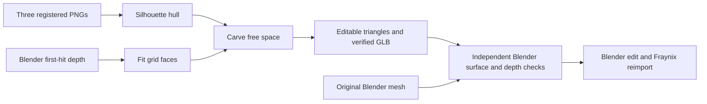

# Recover a hidden recess with first-hit depth

2026-11-24 · Edition 221

The reconstruction keeps the three silhouettes from the same recessed bracket and adds one registered depth grid looking along negative Z. The source generator casts first-hit rays in Blender's evaluated scene. The independent checker rebuilds the authored source, opens Java's GLBs and uses Blender's mesh BVH to cast off-grid rays. It also measures volume and sampled surface distances and renders a withheld oblique view.

## Input and verification contract

- The depth format adds a row-major grid of integer micrometre samples to the existing PNG package. Rays start at the positive Z plane of the centred search cube, point along negative Z and share the +Z silhouette's screen orientation. Rows run from positive Y towards negative Y, and columns run along positive X.
- Each registered hit snaps to the nearest interior voxel face with a tolerance of 500 µm. Java carves occupied cells in front of the fitted face, retains the hit voxel and preserves cells behind it. The output receipt records the declared snap tolerance and maximum snap residual.
- A sample of −1 records background and must agree with the +Z image. A sample of −2 leaves the ray unobserved. An all-unobserved depth package is refused. Use the existing silhouette-only format for that case.
- Java checks that each hit has an occupied cell, that all input silhouettes survive the carve, and that the resulting mesh fits the existing triangle budget. The scene stores the original package and report hashes, and export rechecks the exact bytes after restart.
- Blender's scene-cast input points sit at cell centres. Its verification rays have offset origins within those cells and share the rear direction. A separate oblique render checks a different angle. The retained result supports this synthetic grid-aligned fixture. The model behind an occluder and the behaviour of a physical depth sensor would require separate tests.

The reviewer inspected the earlier silhouette comparison, the implementation and the saved proof. They identified the importance of labelling nearest-face snapping and distinguishing off-grid rear rays from a new camera angle. The suite now tests both edges of the snap allowance and the first rejected value on each side.



## Reproduce

```text
./gradlew :workspace-engine:installDist
./gradlew :workspace-engine:test --tests '*SpatialReconstructionDepthTest'
node workspace-desktop/test/spatial-depth-integration.cjs build/visual-depth221
```

Set `FRAYNIX_TEST_BLENDER` to the Blender executable for the independent mesh comparisons and edit. Without it, the desktop test verifies the bundled Java workflow, exports and restart behaviour. Use `gradlew.bat` on Windows.

The [Blender fixture script](../../workspace-desktop/test/spatial-depth-blender.py) can recreate the registered input. The [desktop evidence](../readmes/221/depth-reconstruction-evidence.json) preserves the exact source hashes and both Blender measurements. The [rendered depth colours](../readmes/221/depth-input-preview.png) represent the original **first-hit** samples, with dark background and warmer colours farther from the near plane.
