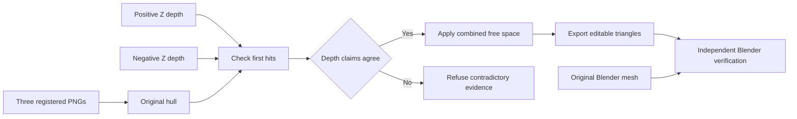

# Combine depth from opposing views

2026-11-24 · Edition 222

Edition 221 recovered one recess from one depth direction. The edition 222 fixture has a second recess on the opposite side. The four control models share the same three PNGs and differ only in the depth supplied. Blender opens all four GLBs and checks the recovered recesses against separately rebuilt original geometry.

## Registration and checks

- The optional multidepth format accepts one or two distinct grids. Both grids are row-major in the same world frame, with +X columns and rows descending along Y. The +Z grid starts on the positive Z face and moves toward negative Z. The −Z grid starts on the negative Z face and moves toward positive Z. A raw negative-Z camera image would need its columns registered to world X before packaging.
- Hits remain integer micrometre distances. The declared 500 µm tolerance snaps each hit to an interior grid face. Each direction’s no-hit and unknown values keep the edition 221 meanings.
- Java validates hits from every view against the same original hull, records free space separately, and checks whether any claim would remove an observed hit. An exact voxel shared by opposing hits is allowed. Each source silhouette must still agree after the combined carve.
- The raw source hash preserves view order and exact bytes. The canonical evidence and editable mesh agree when the order of two valid grids is swapped. The legacy formats and existing scene identity scheme remain compatible.
- The checker casts 196 offset rays in each registered direction, in addition to two separately rendered oblique views. It compares the volumes and maximum sampled surface difference. The unobserved volume between measured faces may still admit other geometry.

The independent reviewer checked the world registration, validation against an immutable hull, the contradictory pair and the one-voxel boundary. They compared the stored source and exported GLB hashes against the receipt and confirmed the separation between the depth generator and Blender verification. The runtime preserves a distinct enclosure for physics.



## Reproduce

```text
./gradlew :workspace-engine:installDist
./gradlew :workspace-engine:test --tests '*SpatialReconstructionMultiDepthTest'
node workspace-desktop/test/spatial-multidepth-integration.cjs build/visual-multidepth222
```

Set `FRAYNIX_TEST_BLENDER` to the Blender executable to run the independent checker. Without it, the desktop test verifies the built-in input, exports, refusal and restart using Java. Use `gradlew.bat` on Windows. The [Blender script](../../workspace-desktop/test/spatial-multidepth-blender.py) can generate a new registered source package. [Saved evidence](../readmes/222/multidepth-evidence.json) records the measurements and exact bytes from the published run.

[Original positive-angle view](../readmes/222/withheld-positive-original.png) · [Reconstructed positive-angle view](../readmes/222/withheld-positive-reconstruction.png) · [Original negative-angle view](../readmes/222/withheld-negative-original.png) · [Reconstructed negative-angle view](../readmes/222/withheld-negative-reconstruction.png)
