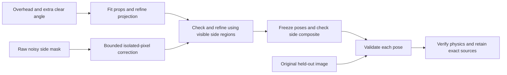

# Edition 253 implementation and reproduction

The four-view preset and its retained receipts keep their existing policy. Opting into cleanup records a distinct input policy and binds the exact noisy image bytes. A single simultaneous pass flips only a pixel whose eight neighbors all disagree with it. At most 9% of raw foreground count, capped at 8,192 pixel changes, can be corrected. The receipt records removed specks, filled holes and raw overlap at the retained pose.

The overhead and extra fitting images still establish shape identity and initial translation and rotation. The new policy refines the projection at subpixel offsets and one-degree angular steps. A bounded local orientation pass uses the corrected side regions outside other props' projections. The original clear-view acceptance and shape-ambiguity checks still apply. Java freezes each refined pose, checks the combined silhouette at the occluded camera, then verifies each pose in the original held-out image. The held-out image can only accept or refuse a finished fit. Native replay keeps the first measured Bullet contact and allows a longer bounded settlement. If the final pair query emits no contact, it also checks the actual resting box against the declared floor plane and footprint at low angular speed. Every terminal support method is written to the receipt.



```powershell
.\gradlew.bat :workspace-engine:installDist
.\gradlew.bat :workspace-engine:test --tests '*SpatialReconstructionTest' --tests '*SpatialExchangeTest' --tests '*PlacementExchangeTest'
npm --prefix workspace-desktop test
node workspace-desktop/test/image-occlusion-integration.cjs build/occlusion-legacy252
node workspace-desktop/test/image-occlusion-noise-integration.cjs build/occlusion-noise253
blender --background --factory-startup --disable-autoexec --python-exit-code 20 --python workspace-desktop/test/image-occlusion-noise-fixtures.py -- build/noise-fixtures
blender --background --factory-startup --disable-autoexec --python-exit-code 20 --python workspace-desktop/test/image-assembly-blender.py -- build/occlusion-noise253/step-behind-elbow
```

Use `./gradlew` on macOS and Linux, and `xvfb-run -a` on Linux without a display. Repeat the last command for each of the four generated scene folders. Portable CI adds the same four-scene desktop and restart test.

A follow-up test can use contiguous mask damage, nearby clutter and camera-scale error. Measure each independently before expanding the supported noise model.

[Edition 252 CI checked first](https://github.com/eyeoverthink/Fraynix-Agent-Workspace/actions/runs/45696647117) · [Measured evidence](../readmes/253/noisy-occlusion-evidence.json) · [Blender reference poses and depth orders](../../workspace-desktop/test/fixtures/image-occlusion-noise/truth.json)
