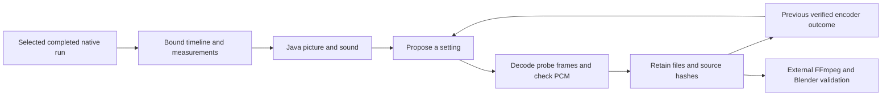

# Edition 254 design and reproduction

## What the outside tools suggest

Blender places pictures, sound, video and scenes on a shared timeline. This release uses that separation to keep the time base and observations distinct from each export format. The timeline records source ticks, position, side orientation, speed and contacts. Java interpolates the native observations to 24 frames per second and assigns 1,000 PCM audio samples to every frame. [Blender Video Sequencer manual](https://docs.blender.org/manual/en/4.4/editors/video_sequencer/introduction.html)

Java writes bounded AVI and WAV containers using the JDK, following the RIFF chunk and index layout. Java checks both stream clocks, frame indexing and PCM consistency. FFmpeg and ffprobe are separate verification tools for the published evidence. Blender imports the produced files. [AVI RIFF specification](https://learn.microsoft.com/en-us/windows/win32/directshow/avi-riff-file-reference) · [ffprobe documentation](https://ffmpeg.org/ffprobe.html)

## How the offline decision works



- **Source.** A Java scene recording supplies the time, point and motion evidence. The recipe binds the retained run, including its scene revision and content hash. The renderer caps a run at 10 native seconds and each output at 16 MB.
- **Candidate.** Java encodes the first, middle and last frame at a trial setting, decodes them and measures RGB peak signal-to-noise ratio. The acceptance floor is 36 dB for each probe. With a previously verified package Java can try its JPEG setting first. The old package's source and artifacts must pass their hashes. The new run still needs three fresh decoded probes and all container checks.
- **Revision.** If a candidate misses the floor, Java tries another setting. Audio gain is independently calculated from the new recording to target 72% peak. The receipt stores the trials and original unscaled over-limit sample count.
- **Retention.** Files become discoverable after the checked receipt is saved. The source and output hashes are checked again before reopening or exporting. A verified package can inform a new candidate. An unsupported file format requires a new exporter with its own verification.
- **Scope.** A recognized local chat phrase invokes this procedure for a selected native recording. The visual output is a 2D side rendering, and the audio is sonification of measured speed. AVI is independently readable in FFmpeg and Blender. Portable tests cover the same Java and Electron flow.

## Ordered development from here

| Phase | Capability | Acceptance evidence |
| --- | --- | --- |
| Delivered | Native motion to video, WAV, PNG and JSON | Exact restart replay on two runs. Independent decode and editable Blender import. |
| Next | Let users compose clips, stills and audio on an editable multi-track timeline | Independently test cut points, audio alignment, reopen and edit without changing the original export. |
| Then | Add specified 2D graphics, synthesized audio and verified 3D scene sources | Each source adapter declares its time and units and passes tests on fresh examples. |
| Then | Add formats when a real workflow needs them | Independent readers validate each new encoder or exchange format, including metadata and edge cases. |
| Then | Expand the local task vocabulary and outcome memory | Measure routing accuracy, refusals, complete workflow costs and reproducible gains before promoting a learned choice. |

## Reproduce

```powershell
.\gradlew.bat :workspace-engine:installDist
npm --prefix workspace-desktop test
node workspace-desktop/test/motion-media-integration.cjs build/motion-media254
node workspace-desktop/test/motion-media-ffmpeg.cjs build/motion-media254
blender --background --factory-startup --disable-autoexec --python-exit-code 20 --python workspace-desktop/test/motion-media-blender.py -- build/motion-media254
```

On macOS and Linux use `./gradlew`. Use `xvfb-run -a` for the Electron test on a Linux runner without a display. External FFmpeg and Blender are required only for their independent validation commands. The published runs and measurements are Windows results.

[Edition 253 CI](https://github.com/eyeoverthink/Fraynix-Agent-Workspace/actions/runs/45701423650) · [Measured evidence](../readmes/254/media-evidence.json) · [Independent decode](../readmes/254/independent-decode.json)
