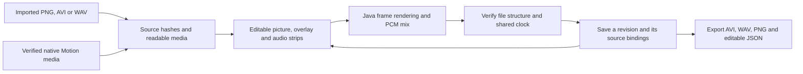

# Edition 255 implementation and reproduction

The editor separates source assets, editable timing, and verified outputs. A timeline strip names a source and lane and fixes the destination start, source offset, and duration in whole frames. Audio gives each frame exactly 1,000 samples. Picture clips are fitted to the canvas, PNG overlays use alpha and independent placement, and audio lanes are summed. When the source mix exceeds full scale, Java scales the mix from the actual peak before encoding and retains the decision in the receipt.



## Acceptance checks

| Capability | Independent check |
| --- | --- |
| Imported AVI | FFmpeg authored two colors. A trim across the source boundary changed the decoded frame at the same destination cut. |
| Imported PNG | A known transparent rectangle appeared at the expected coordinate and remained transparent outside its painted region. The expected appearance began at frame 4 and ended before frame 16. The same still formed the last picture strip. |
| Imported and generated audio | A separate script rebuilt the mix from the source bytes and exact sample offsets. It compared every sample with both exported audio streams. |
| Output portability | FFmpeg decoded picture and PCM. Blender imported aligned video and sound strips. |
| Restart and source integrity | Both revisions retained exact file hashes. The wrong source range, unwanted overlaps, unreadable AVI, and a modified retained source were refused. |

The graphic, cue WAV, and cut fixture were authored independently of the Java renderer. Source provenance distinguishes imported bytes from generated media. A new revision validates its parent before saving. Reopening checks every retained source and the four output hashes. Exported edit JSON describes the cuts and source identifiers in the current project. A portable package that carries source bytes and the editable definition together is a separate exchange feature to validate.

## Reproduce

```powershell
.\gradlew.bat :workspace-engine:installDist
npm --prefix workspace-desktop test
node workspace-desktop/test/timeline-editor-integration.cjs build/timeline255
node workspace-desktop/test/timeline-ffmpeg.cjs build/timeline255
blender --background --factory-startup --disable-autoexec --python-exit-code 20 --python workspace-desktop/test/timeline-blender.py -- build/timeline255
python workspace-desktop/test/timeline-fixtures.py build/timeline-fixtures
```

On macOS and Linux use `./gradlew`. On Linux without a display, run Electron tests through `xvfb-run -a`. FFmpeg and Blender run as external acceptance readers. The workspace itself renders and verifies with Java.

[Edition 254 CI](https://github.com/eyeoverthink/Fraynix-Agent-Workspace/actions/runs/45705198573) · [Measured evidence](../readmes/255/timeline-evidence.json) · [Independent decode](../readmes/255/independent-timeline.json) · [AVI format reference](https://learn.microsoft.com/en-us/windows/win32/directshow/avi-riff-file-reference)
