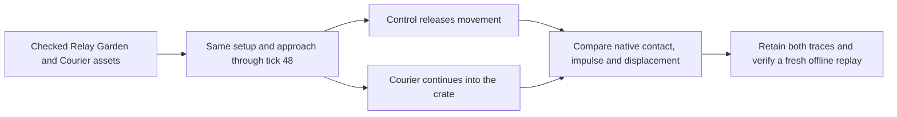

# Edition 271 implementation and verification

## The native scene

The practice scene opens a checked Relay Garden source with the original PlayerController, StateMachine, dynamic pill-shaped collider and fixed rotation. It adds one dynamic crate and uses the verified Teal Courier pose atlas for the separate render component. Opening the ordinary Relay Garden follows its existing path. The dedicated practice scene uses the bundled Teal atlas. User-baked rig selection and transfer to other Game Lab scenes are follow-up work.

## How the push is measured

The native runtime runs two fresh scenes at 60 Hz with 24 settling ticks and the same 24-tick approach. The control releases movement and the push continues to tick 120. No command applies force to the crate directly. The JBox2D contact listener logs the crate position at first contact. The solver's contact callback then records the normal impulse when the pair's contact normal has a substantial horizontal component. The final row for a tick samples JBox2D body coordinates and velocity after that step returns.

The separate workspace verifier checks dynamic body types, matching masses, exact shared input and samples, contact order, a 0.00025-game-unit motion threshold and at least 0.15 units of displacement in the push. It rejects pre-contact travel, a moving/contacting control or a missing contact or impulse. Both traces and the scene, content manifest and artwork identities are hashed as one receipt. Replay rechecks the retained record, creates a fresh native process and requires the same receipt from newly measured traces. Editing the original receipt causes refusal before runtime launch.

## Local results and CI

- The visible movement buttons approached without changing the crate X coordinate, then pushed it on contact. Reset restored the starting scene.
- The paired trial had 121 samples per run. At tick 69, the crate was still at X = 1.620 inside the contact callback. The first horizontal-normal impulse was 0.08120056 in engine units. The completed tick first exceeded the motion threshold. No horizontal change was measured before contact.
- Continued movement displaced the crate by 1.003840 game units. The approach that released movement recorded zero crate contacts, impulses and horizontal displacement.
- Restart with Fraynix offline and models disabled used a new embedded process. Both traces matched, the native PNG hash matched, and the checked export matched the original receipt. A changed receipt was refused in place.
- The Windows build, all 191 desktop tests and the original Relay Garden smoke test passed locally. The previous portable avatar tests passed across four targets. Later spatial tests failed on three targets and the Intel Mac job was cancelled. Edition 271 adds the new test to portable CI and reports the specific OpenGL startup limitation on hosted Macs if it occurs. [Edition 270 portable CI](https://github.com/eyeoverthink/Fraynix-Agent-Workspace/actions/runs/46081318218)

## Reproduce

Prepare both Java builds with `./gradlew :prepareGameRuntime115 :workspace-engine:installDist` or `gradlew.bat :prepareGameRuntime115 :workspace-engine:installDist` and run `npm --prefix workspace-desktop ci`. From the repository root, run `node workspace-desktop/test/courier-crate-integration.cjs build/courier-crate`. On Linux without a display, prefix the command with `xvfb-run -a`.

## Next measurable step

Run the paired test from both directions and repeat it with different crate masses and an obstacle. Keep the contact order and no-contact control, then add a reviewed native skill that moves a crate to a target and verifies the final position after the Courier releases movement. Use the same receipt to test how much the skill generalizes when friction or approach speed changes.

[Previous character rig](../../README-270.md) · [Download the measured replay](../readmes/271/courier-crate-proof.json)
