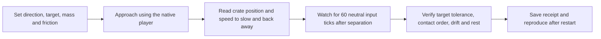

# Edition 272 implementation and verification

## The controlled delivery scene

The delivery practice scene uses the verified Relay Garden art, the existing dynamic Courier pillbox and its PlayerController. Low-speed trials exposed tile seam interference and an effective player mass much lower than the authored body value. The delivery fixture uses a continuous deck under the original tiles and applies the authored density to the existing player fixtures. The crate's requested mass is converted to the density of its native box. The verifier compares the actual JBox2D mass and friction with the requested values.

The supported target distance is 0.30–1.00 game units in either direction, crate mass is 0.35–1.30 and crate fixture friction is 0.06–0.75. The crate starts at X = 2.08. The player starts on the correct side for the chosen approach. The green marker is visual. The supported test space is a clear, level delivery lane.

## Control and authority

The controller drives the existing player inputs. It caps approach speed, slows near the target and estimates how far the crate can travel while the player brakes. It then reverses until contact has cleared for eight ticks. The crate's motion comes from the native solver. A neutral hold records every tick after release. Java independently checks initial source and body settings, the order of contact, horizontal impulse and first observed motion, zero contact and input during the hold, an error of at most 0.035 units and drift of at most 0.018. The final horizontal speed must be at most 0.008 game units per second.

## Verified on Windows

- The full factorial covered distances of 0.32, 0.65 and 0.93, masses of 0.35, 0.78 and 1.30, and friction of 0.06, 0.40 and 0.75 in both directions. Four extra cases covered ±0.30 and ±1.00 with intermediate mass and friction.
- All 58 finished inside the hold band. Worst held error was 0.0245726, maximum drift was 0.0009540, and every final horizontal speed was zero.
- The app reopened all 58 receipts after offline restart. A new native process replayed each of the two demonstrations, one in each direction, to the exact tick trace and native PNG.
- An out-of-range mass was refused without replacing the current run. A receipt with changed bytes was refused. A rehashed trace that leaves the band for one tick was independently refused, even with an unchanged endpoint.
- All 191 desktop tests passed. The edition 271 paired push still produced the same proof ID and native frame on Windows. Its dedicated CI step succeeded on all four targets. Its portable matrix encountered later chart and spatial failures, and the Intel Mac job was cancelled. Edition 272 has a separate portable CI step. [Edition 271 portable CI](https://github.com/eyeoverthink/Fraynix-Agent-Workspace/actions/runs/46085059042)

## Reproduce

Prepare the runtime with `./gradlew :prepareGameRuntime115 :workspace-engine:installDist` or `gradlew.bat :prepareGameRuntime115 :workspace-engine:installDist`. Install desktop dependencies with `npm --prefix workspace-desktop ci`. Run `node workspace-desktop/test/courier-target-integration.cjs build/courier-target` from the repository root. Use `xvfb-run -a` before the test on Linux without a display.

## Next measurable step

Add obstacle approaches, varied support and an external disturbance during delivery. Compare the current controller with a slower baseline and verify recovery from a stop short of the target before promoting a broader skill.

[Prior contact experiment](../../README-271.md) · [The 58 measured cases](../readmes/272/courier-target-matrix.json)
