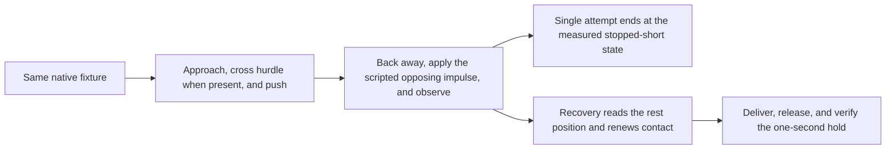

# Edition 273 implementation and verification

## What runs

Game Lab uses the existing dynamic Courier body and authenticated native runtime. The fixture varies four factors independently. Direction is left or right, deck friction is 0.065 or 0.32, the 0.13-unit rigid hurdle is present or absent, and the disturbance is enabled or disabled. Both policies in a comparison start with identical body settings and geometry. Crate mass is 0.78, crate fixture friction is 0.28, and the target lies 0.77 game units from the start.

The approach reads the actual static fixture's position and uses the existing player jump input. The proof checks body height as it crosses the hurdle, before the first crate contact. The delivery controller changes pace near the target and backs away to end contact.

## The paired interruption

In interrupted trials, the fixture requests separation after the crate advances 0.25 units. After 16 contact-free ticks it applies a native impulse equivalent to a velocity change of 0.26 game units per second against the direction of travel. The 60-tick neutral observation measures that the crate has come to rest. The recovery controller resumes once if the crate is stationary and at least 0.18 units short. The slower baseline gets one attempt and keeps the measured shortfall. Both use the same final runout estimate and verify the same hold band. This comparison changes pace and retry authority together.

Java checks ordered samples, source identities, support properties, hurdle clearance, contact before crate movement, the actual impulse, the unaided stop, renewed collision impulse during recovery, and the entire final hold. A late baseline miss remains visible in the evidence. The paired study is accepted when the recovery controller has demonstrably delivered.

## Measured results

- Both controllers cleared every installed hurdle. The recovery controller delivered in 16 of 16 cases. The baseline delivered in four cases, stopped after all eight interruptions, and held outside tolerance in four uninterrupted high-friction cases.
- The recovery controller observed a shortfall of 0.439–0.482 game units before renewing contact. In the rightward hurdle case, it crossed at tick 87, observed the disturbance at 165, regained contact at 248 and released at 355. Verified delivery ended at tick 415.
- Shared successes finished 45–47 ticks sooner with the recovery controller. Interrupted successful runs took 384–429 ticks including the two observation windows. The worst error during the final hold was 0.023373, with zero measured drift.
- Windows reopened all 16 receipts with the app offline and models disabled. Two fresh native clients reproduced both policies' traces and the final frames. A rehashed invalid hold and changed receipt were refused. The checked JSON export matched.
- The local Java builds and 191 desktop tests passed. The edition 272 Windows regression repeated all 58 cases and kept its previously published replay identities and frames. Edition 272's dedicated delivery CI step succeeded on all four targets. Its full workflow encountered later spatial failures and an Intel Mac cancellation. [Edition 272 portable CI](https://github.com/eyeoverthink/Fraynix-Agent-Workspace/actions/runs/46093179592)

## Reproduce

Prepare both Java builds with `./gradlew :prepareGameRuntime115 :workspace-engine:installDist` or `gradlew.bat :prepareGameRuntime115 :workspace-engine:installDist`, then run `npm --prefix workspace-desktop ci`. From the repository root, run `node workspace-desktop/test/courier-recovery-integration.cjs build/courier-recovery`. On Linux without a display, run it under `xvfb-run -a`.

## Next design test

Separate pace from retry in equal-speed comparisons and test unfamiliar obstacle shapes and disturbance times. The current fixtures use one hurdle shape, one crate, and a deliberate mid-delivery interruption. A broader skill needs to demonstrate the same verified hold when a disturbance arrives without a scripted stop.

[Prior delivery tests](../../README-272.md) · [Complete comparison summary](../readmes/273/courier-recovery-matrix.json)
