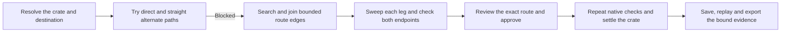

# Edition 276 implementation and verification

## What runs

A resolved crate retains its scene, source hash and exact door-relative 40 cm destination. Java measures the direct move and the edition 275 straight alternatives first. When those fail and the existing aisle is clear, the route planner searches a grid in the door’s local coordinates. It advances in 10 cm increments and checks 15 cm lateral steps up to 90 cm either side. It keeps the crate upright and the heading fixed. The route may move sideways and forward and has a 2.20 m path budget.

The search examines cheaper paths first in fresh, unstepped Bullet state. After it reaches the original target, it joins consecutive collinear edges and verifies each resulting segment again. The approved waypoints come from bounded integer grid coordinates, so the saved geometry can be regenerated from the retained scene.

## What the verifier measures

Each leg checks the crate footprint at both ends and sweeps the original oriented collider against scene objects and the one-metre reserved aisle. The sweep uses the actual path height and excludes the designated support floor. The original aisle, authored destination aisle and settled aisle all pass the existing clearance checks. The last 60 ticks verify support and low motion at the destination. The source comparison allows the approved crate position and revision title.

Java compares the result with the preview, rechecks the direct obstruction, repeats the verification in a separate native run and saves the editable destination only after agreement. The approved route and witnesses become part of the retained scene receipt. Replay remeasures the same sequence after restart. The workflow verifies an authored scene edit using collider sweeps and a separate native settle at its destination.

## Results

| Windows test | Result |
| --- | --- |
| Staggered bay, −41° | Shift right, advance, cross left between barriers, advance, return to the original lateral line. |
| Mirrored staggered bay, 83° | Reverse the lateral directions. Both routes passed all five checked legs, with lengths of 30, 20, 60, 20 and 30 cm. |
| Blocked crossover, −118° | All eight straight alternatives and 33 route-edge checks failed to find a complete route. No child scene was saved. |
| Independent late-leg check | A route with clear endpoints at leg 3 hit the outside barrier in its continuous sweep. |
| Independent aisle control | A proposed sweep with clear endpoints on either side of the aisle was rejected for crossing the aisle. |

The desktop test passed with networking blocked and models disabled. The pending proposal and its exact map reopened after one restart. The second restart reproduced all legs, both shelves, the supported destination and the exact export. Changed waypoint evidence and wrong approvals refused. The edition 275 desktop regression, four targeted Java tests, and 191 desktop unit tests passed. These results use declared-scale synthetic layouts. [Complete routes and blocked result](../readmes/276/result.json) · [Scene and evidence](../readmes/276/route-verified.json)

Edition 275’s dedicated loading-bay step completed successfully on all four hosted targets. Edition 276 adds its own segmented-route test to the same portable matrix. [Edition 275 CI](https://github.com/eyeoverthink/Fraynix-Agent-Workspace/actions/runs/46104059695)

## Reproduce

Run `./gradlew :workspace-engine:installDist` or `gradlew.bat :workspace-engine:installDist` and `npm --prefix workspace-desktop ci`. Run `node workspace-desktop/test/loading-aisle-route-integration.cjs build/loading-aisle-route` from the repository root. Use `xvfb-run -a` on Linux without a display. `:workspace-engine:test --tests '*LoadingAisle*'` runs the independent Java cases.

A follow-up can vary crate widths and approach distances, then measure whether a second search resolution recovers useful routes within the same time and clearance budgets.
