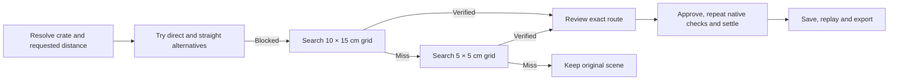

# Edition 277 implementation and verification

## Request and intent

Chat resolves one crate and parses the declared advance in centimetres, millimetres or metres. Java accepts exact whole-centimetre distances from 40 through 200 cm, including older 40 cm wording. The original input, exact object, parent hash, destination and route stay bound to approval. The distance remains exact when the final grid interval is shorter. The 173 cm case reached its named destination with zero net lateral motion.

## Resolution, budget and verification

Both grids measure forward and lateral offsets from the crate in the door frame. They preserve the original destination and use the crate’s actual oriented dimensions. The search is forward-only with side shifts up to 90 cm either way. The path budget is the requested forward distance plus 1.80 m, with up to 12 consolidated legs for new routes. The published edition 276 grid and its receipt format remain available for older 40 cm routes.

The finer grid runs only when the coarser grid has no verified route. The UI and receipt show which resolution succeeded and the edge checks used by each search. The two recovered cases cost 571 and 837 additional edge checks. The open-crossover control used 114 coarse checks and never entered the finer search.

Java rechecks the exact saved route’s source, collider sweeps, each waypoint, the reserved one-metre aisle and the final 60 supported ticks. The two native verification runs must agree. Checking the original blocker justifies the detour. Replay verifies the saved legs again using the same source. The receipt keeps the measured search counts from planning. Java applies an authored destination edit after sweep and settle verification.

## Results

| Test bay | Crate width | Requested advance | Coarse edges checked | Fine edges checked | Result |
| --- | ---: | ---: | ---: | ---: | --- |
| Wide crate, −53° | 42 cm | 1.20 m | 66 | 571 | 6 legs · 2.60 m traveled |
| Wide mirrored, 96° | 58 cm | 1.73 m | 57 | 837 | 10 legs · 3.53 m traveled |
| Open crossover, 27° | 42 cm | 1.20 m | 114 | 0 | 6 legs · 3.00 m traveled |
| Oversize, −127° | 74 cm | 1.20 m | 53 | 244 | Refused |

All accepted routes kept both shelves and all other authored objects intact. The width and clearance results apply to the declared-scale synthetic bays. Both bounded searches refused the deeper oversize crate.

The local Java tests independently demonstrated the coarse miss and exact 173 cm destination on the finer grid. Windows exercised two offline restarts, retained the exact map and export, and refused altered evidence and wrong approval. The edition 276 regression and 191 desktop unit tests passed. [Desktop results](../readmes/277/result.json) · [Editable scene and exact receipt](../readmes/277/fine-verified.json)

Edition 276’s dedicated route test passed on all four CI targets. The broader portable suite later hit mesh and collider failures and an Intel job cancellation. Edition 277 adds a dedicated wide-crate test to that matrix. [Edition 276 CI](https://github.com/eyeoverthink/Fraynix-Agent-Workspace/actions/runs/46105726089)

## Reproduce

Run `./gradlew :workspace-engine:installDist` or `gradlew.bat :workspace-engine:installDist` and `npm --prefix workspace-desktop ci`. Then run `node workspace-desktop/test/loading-aisle-resolution-integration.cjs build/loading-aisle-resolution` from the repository root. Use `xvfb-run -a` on Linux without a display. The independent Java tests run with `:workspace-engine:test --tests '*LoadingAisle*'`.

A next comparison can test whether spending fine checks only near blocked transitions recovers the same verified routes with fewer queries.
