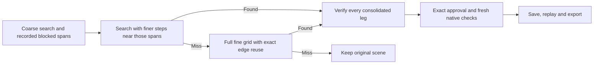

# Edition 278 implementation and verification

## Where refinement happens

The route planner keeps its direct and straight alternate checks. When the coarse grid misses, it records which forward edges failed native path or destination checks. It enables 5 cm steps within 10 cm of those coarse spans. Outside those bands, it uses wider steps, with fine lateral steps available at the exact destination. The localized search prioritizes paths by their traveled distance plus a lower bound on the remaining distance. It has a 360-native-edge budget.

If localized planning fails or reaches its budget, the planner runs the full fine grid. Within that request, the fallback can reuse previously measured edges with the same directed endpoints and exact parent and crate binding. The approved route retains its search counts and the chosen policy. Earlier saved routes keep their original receipt shape.

## Paired work and outcomes

| Test layout | Prior edge checks | Current edge checks | Current outcome |
| --- | ---: | ---: | --- |
| 42 cm crate, 1.20 m | 637 | 307 | Local route |
| 58 cm crate, 1.73 m | 894 | 393 | Local route |
| Open crossover | 114 | 114 | Coarse route |
| 74 cm crate | 297 | 298 | Refused |
| Two crossovers, 2.00 m | 1012 | 1123 | Full fine fallback |

The comparison counts actual native edge evaluations across all grid passes after the common direct and straight attempts. It excludes unchanged approval and replay checks. The uncached baseline and the current planner used the same rotated source scenes, crates and destinations. Java independently verified both results.

The local results matched baseline distance and destination. The 42 cm case changed from six to eight legs, and the 58 cm case from ten to eleven. The two-crossover test needed the full grid and used 111 more evaluations after reusing 249 exact directed edges. The oversized refusal used one more evaluation. Across these five declared-scale synthetic cases, the total fell from 2,954 to 2,235. The counts measure native search work.

## Verification and reproduction

Every accepted route requires exact approval and repeats all leg, waypoint, aisle and settlement checks in fresh native worlds. The search cache has no role in approval or replay. Windows restored the pending local route, then reverified the approved local result and full-grid fallback during three offline restarts. A changed search record and incorrect approval were refused. The edition 276 desktop regression and 191 desktop unit tests passed. [Paired results](../readmes/278/comparison.json) · [Offline results](../readmes/278/result.json)

Edition 277’s dedicated wide-crate test passed on all four hosted targets. Later mesh and collider steps failed on three runners, and the Intel Mac job was cancelled. [Edition 277 CI](https://github.com/eyeoverthink/Fraynix-Agent-Workspace/actions/runs/46108779221)

Run `./gradlew :workspace-engine:installDist` or `gradlew.bat :workspace-engine:installDist` and `npm --prefix workspace-desktop ci`. Run `node workspace-desktop/test/loading-aisle-resolution-integration.cjs build/loading-aisle-resolution` for the desktop scenarios. Use `xvfb-run -a` on Linux without a display. Run `:workspace-engine:test --tests '*LoadingAisleLocalizedTest'` with Gradle for the five paired measurements.

A next comparison can keep the search savings and test whether simplifying equal-distance routes reduces turns and approval work.
