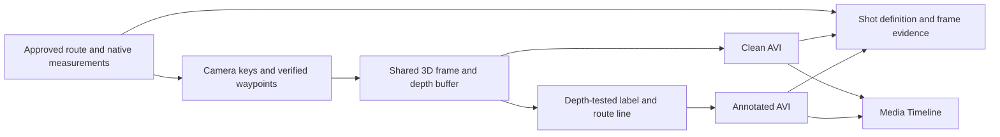

# Edition 279 implementation and verification

## Spatial to Media

Exact crate approval and native route measurements remain the source of the shot. Java independently replays those checks before recording a new camera revision and before replaying a saved take. Each frame follows the verified route waypoints by distance. Both takes use exactly the same camera, solid surfaces and crate position. The rendered line is a world-space layer on the floor and the billboard faces the current camera from its 3D attachment point.

For each frame, the rasterizer records label coverage and checks its center pixel against a separate ray intersection with the world-oriented boxes. The saved AVI streams are indexed and each JPEG is decoded. A replay checks exact source and approval, rebuilds the route measurements, generates both takes and compares their verification rows and byte hashes. The media source binding checks these same shot and route identities when a timeline revision is opened.

## Reproduce

1. Build the local Java distribution with `./gradlew :workspace-engine:installDist`. On Windows use `gradlew.bat`.
2. Run `node workspace-desktop/test/route-shot-integration.cjs build/route-shot` from the repository root. On Linux run it under `xvfb-run -a` when a graphical display is unavailable.
3. To have FFmpeg and ffprobe independently inspect the exports, make both available on PATH and set `FRAYNIX_ROUTE_SHOT_FFMPEG=1` before running the test.
4. Review the output images, both AVI files, the camera JSON and the result record in the selected output folder.

The desktop test uses the documented public test bay and an isolated offline project. It verifies both takes, an independently edited camera key, reopening after restart, a real Media Timeline cut, and source/media-change refusal. Prior CI run [46115547468](https://github.com/eyeoverthink/Fraynix-Agent-Workspace/actions/runs/46115547468) passed the preceding crate route steps on all four runners and later failed at mesh and browser trace checks on Windows and Apple Silicon.

## Next design test

Film a changed scene with a different tracked object and a distinct occluder. Add an editable overlay track that retains its 3D attachment across camera changes, then test whether a second editor can revise that track and verify an exported shot from a clean project.
