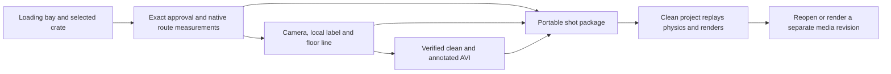

# Edition 280 implementation and verification

## Editable overlays

The label has editable dimensions, RGB color, text and visibility. Java rotates the local attachment by the crate's original orientation before adding the sampled position. The label faces the camera from that attachment. The floor line follows the verified path and has editable elevation, width, color and visibility. Both takes use the same geometry and camera. Frame evidence includes the attachment, coverage, center occluder and visible route pixels. A fixed bitmap typeface draws labels without using host fonts.

## Transfer checks

The package carries the original scene text, crate clarification if present, review, approval and measurements. The recipient checks those relationships, rebuilds the source and candidate definitions and repeats the native measurements. It rerenders both streams and checks all frame evidence and exact bytes before retaining the package. The shot store preserves the evidence independently of the active world. Earlier camera-only shots reopen using their original format and renderer. Save an overlay revision to make a camera-only shot exportable as a portable shot.

## Reproduce

1. From the repository root build the Java distribution with `./gradlew :workspace-engine:installDist`. On Windows use `gradlew.bat :workspace-engine:installDist`.
2. Run `node workspace-desktop/test/route-shot-portable-integration.cjs build/route-shot-portable`. Use `xvfb-run -a` when a Linux host has no desktop display.
3. Set `FRAYNIX_ROUTE_SHOT_FFMPEG=1` with FFmpeg and ffprobe on PATH for independent timing and decode checks.
4. The output folder contains the portable package, both AVI exports, frame audit and captured screenshots. The documented Windows package is 4,316,687 bytes. The [result record](../readmes/280/result.json) contains its SHA-256.
5. For a manual clean-project test, launch the desktop with a separate directory in `FRAYNIX_WORKSPACE_PROJECT`. Import the package and restart with the same directory.

The two-project desktop test passed locally on Windows. The portable CI workflow runs the same verification on Windows, macOS and Linux and uploads the generated samples. Edition 279's dedicated route-shot check passed on all four hosted runners. [Edition 279 hosted check](https://github.com/eyeoverthink/Fraynix-Agent-Workspace/actions/runs/46121612070)

## Next design test

Try multiple editable object labels with a held-out angle. Measure whether a second editor can change overlay timing and reproduce the cut in another renderer.
