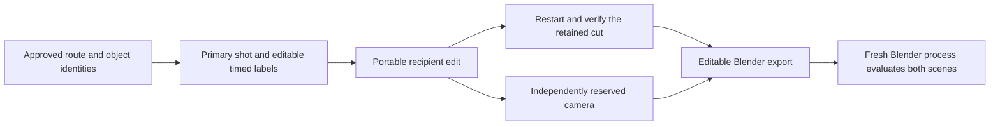

# Edition 281 implementation and verification

## Timing and camera authority

The Java renderer checks a label's attachment in the referenced body's local coordinates. The time gate runs before drawing, so an inactive label contributes zero pixels. The rasterizer uses the normal scene depth buffer, records visible pixels for each label and checks the scene occluder at its center sample with an oriented-box ray. Each cut retains exact camera poses and the serialized timing schedule. Source identity, native route replay and byte-exact video checks still run for the portable package.

The reserved camera uses a fixed, source-relative high viewpoint across the route from the ordinary primary camera. Its poses are generated independently of label placement and timings. The verifier refuses a pair whose view directions ever approach within 20°. It runs the same revision across the reserved view without changing the cut.

## Independent Blender replay

The exporter maps Java's Y-up metres into Blender's Z-up frame. It writes actual box meshes, keyed crate translations, two editable cameras and a separate text plate attached to each object. Blender evaluates its own visibility curves. A separate process opens the saved .blend and verifies projected anchors, timings and occlusion against Blender's evaluated meshes using its BVH. The paired PNGs are rendered in that second process.

## Reproduce

1. Build with `./gradlew :workspace-engine:installDist` or the Windows Gradle wrapper.
2. Run `node workspace-desktop/test/route-shot-timed-integration.cjs build/timed-route-shot`. Use `xvfb-run -a` on a headless Linux runner.
3. Set `FRAYNIX_ROUTE_SHOT_BLENDER=1` to include Blender export, fresh-process checks and the two renders. If needed, point `FRAYNIX_BLENDER` to the local Blender executable.
4. The output folder includes original and edited portable packages, the Blender source data, the two screenshots and, with Blender enabled, the actual .blend, paired renders and readback.

The Windows run used Blender 5.3.0. Hosted edition 281 runs the recipient and reserved-angle check across Windows, macOS and Linux. Edition 280's portable-shot step passed on all four runners. Its full workflow later failed in the mesh and browser-trace step on Windows and Apple Silicon. [Edition 280 CI](https://github.com/eyeoverthink/Fraynix-Agent-Workspace/actions/runs/46122986705)

## Next design test

Let a recipient change approved overlay timing in Blender, import only those changes and repeat the replay. Test intentional timing edits and refuse unrelated camera or geometry changes.
